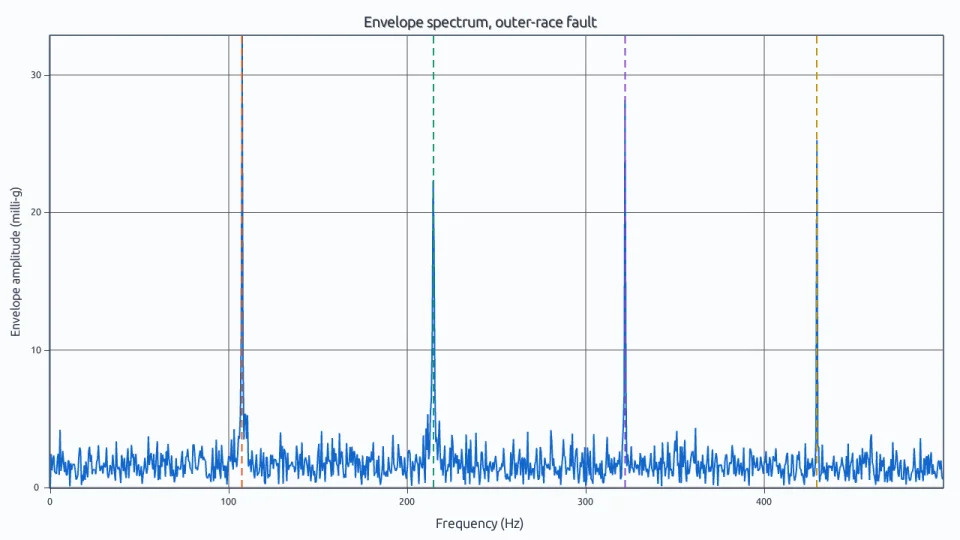

# Detecting a bearing outer-race fault with envelope analysis

[](https://runmat.com/sandbox?example=industrial-machinery-bearing-envelope)

This example finds an outer-race defect on a 6205 deep-groove ball bearing from a vibration
signal. It band-passes the accelerometer signal around a 3 kHz housing resonance, takes the
envelope, and looks for a peak in the envelope spectrum. The bearing geometry puts the outer-race
defect frequency at 107.4 Hz for a shaft at 1,797 rpm, and the envelope spectrum peaks at 107.5 Hz.

<picture>
  <source media="(prefers-color-scheme: dark)" srcset=".artifacts/thumbnail.webp">
  
</picture>

## The problem

A spall on a bearing race produces a short impact each time a rolling element passes over it. Each
impact rings the bearing housing at its own resonance, often several kilohertz, so a plain spectrum
of the vibration shows energy near the resonance and little at the defect rate. Envelope analysis
(amplitude demodulation) recovers the rate: filter around the resonance, take the magnitude of the
analytic signal, and compute the spectrum of that envelope. A peak at a bearing defect frequency
and its harmonics identifies the damaged part.

For a stationary outer race, the ball pass frequency outer (BPFO) is

$$\text{BPFO} = \frac{n}{2} f_r \left(1 - \frac{d}{D}\cos\phi\right)$$

with n balls of diameter d on pitch diameter D, contact angle φ, and shaft frequency f_r. The 6205
has 9 balls of 7.94 mm on a 39.04 mm pitch diameter, with φ = 0.

## How the example works

1. **Compute the defect frequency** from the bearing geometry and the 29.95 Hz shaft speed:

   ```matlab
   fs = 12000;  fr = 1797/60;
   n = 9;  d = 7.94;  D = 39.04;  phi = 0;
   bpfo = n/2 * fr * (1 - d/D*cos(phi));
   ```

2. **Make the test signal.** The local function `test_signal` builds two seconds at 12 kHz: an
   impact at every BPFO period, each ringing a 3 kHz resonance that decays at 1500 s⁻¹, plus shaft
   vibration at f_r and Gaussian noise.

3. **Band-pass and demodulate.** A 4th-order Butterworth filter passes 2–4 kHz, `filtfilt` runs it
   with zero phase, and `hilbert` gives the analytic signal whose magnitude is the envelope:

   ```matlab
   [b, a] = butter(4, [2000 4000]/(fs/2));
   env = abs(hilbert(filtfilt(b, a, x)));
   E = abs(fft(env - mean(env))) / numel(env);
   ```

4. **Find the peak** between 50 and 300 Hz and plot the spectrum to 500 Hz, with dashed lines at
   1×, 2×, 3× and 4× BPFO.

## Results

```
outer-race defect frequency 107.4 Hz from the bearing geometry
envelope spectrum peaks at 107.5 Hz
```

The envelope spectrum has a resolution of 0.5 Hz over the two-second record, so the 107.5 Hz bin
is the nearest one to the 107.4 Hz defect frequency. The plot shows clear peaks on all four
harmonic markers, standing well above the noise floor, which is the usual signature of an
outer-race fault. The shaft frequency at 29.95 Hz carries no peak in the envelope spectrum,
because the band-pass filter removes it before demodulation.

## What to try

1. Move the band to `[500 1500]`, away from the 3 kHz resonance, and compare the height of the
   defect peaks with the noise floor.
2. Raise the noise in `test_signal` from `0.3*randn` to `1.0*randn` and see how many harmonics
   still stand out.
3. Compute the inner-race frequency, `n/2 * fr * (1 + d/D*cos(phi))`, which is 162.2 Hz for this
   bearing, and add its marker to the plot. A healthy inner race shows no peak there.

## Files

- `bearing-envelope.m`: the script: defect frequency, test signal, band-pass, envelope spectrum and the plot.
- `runmat.toml`: the project file.

## Related

- [Industrial machinery in RunMat](https://runmat.com/industries/industrial-machinery)
- [Broken rotor bar in a motor's current spectrum](../motor-current): a second machine fault found in a spectrum
- Function reference: [`butter`](https://runmat.com/docs/reference/builtins/butter), [`filtfilt`](https://runmat.com/docs/reference/builtins/filtfilt), [`hilbert`](https://runmat.com/docs/reference/builtins/hilbert), [`fft`](https://runmat.com/docs/reference/builtins/fft)
- [Download RunMat](https://runmat.com/download)
