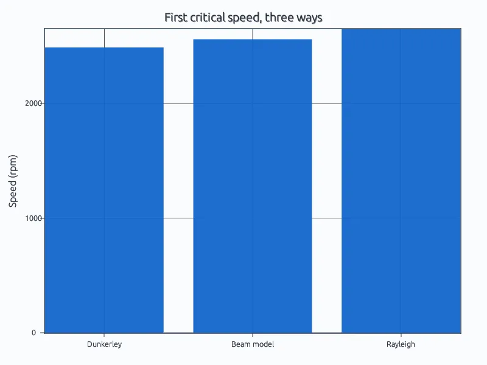

# First critical speed of a two-disc shaft: Dunkerley, beam model and Rayleigh

[](https://runmat.com/sandbox?example=industrial-machinery-critical-speed)

This example computes the first critical speed of a stepped steel shaft on two bearings 1.2 m
apart, carrying a 25 kg and a 40 kg disc, three ways. A 48-element beam model gives 2561 rpm.
Dunkerley's method gives 2489 rpm, a lower bound, and Rayleigh's method gives 2648 rpm, an upper
bound, so both hand methods bracket the beam result within 87 rpm.

<picture>
  <source media="(prefers-color-scheme: dark)" srcset=".artifacts/thumbnail.webp">
  
</picture>

## The problem

A rotor whirls violently when its running speed reaches a natural bending frequency, its critical
speed. Machine designers keep the operating speed a safe margin away from it, so they need the
first critical speed early, often before a detailed model exists. Two classic estimates bracket it:

- **Dunkerley's method** adds the inverse squares of the frequencies of each mass acting alone,
  which always underestimates the combined frequency:

  $$\frac{1}{\omega^2} \approx \frac{1}{\omega_s^2} + \sum_j m_j \, a_{jj}$$

  where ω_s is the bare shaft's frequency and a_jj is the flexibility at disc j.

- **Rayleigh's method** takes the static deflection y under each weight W as the mode shape, which
  always overestimates the frequency:

  $$\omega^2 = g \, \frac{\sum W_i y_i}{\sum W_i y_i^2}$$

The shaft is 50 mm in diameter, stepping up to 70 mm between 0.3 m and 0.9 m. The discs sit at
0.4 m and 0.8 m. Steel has E = 210 GPa and ρ = 7850 kg/m³, and the bearings are simple supports.

## How the example works

1. **Assemble the beam model** with Euler-Bernoulli elements, two degrees of freedom per node, and
   consistent mass matrices:

   ```matlab
   dia = 0.05 + 0.02*(xm > 0.3 & xm < 0.9);
   K(q, q) = K(q, q) + ke;  Ms(q, q) = Ms(q, q) + me;
   ```

2. **Add the discs** as point masses on the deflection degrees of freedom of their nodes, pin both
   ends, and solve for the lowest eigenvalue:

   ```matlab
   beam = sqrt(min(eig(Kf, M(free, free))));
   ```

3. **Apply Dunkerley.** The bare shaft's frequency comes from the shaft mass alone, and each disc
   adds its mass times the diagonal of the flexibility matrix `F = inv(Kf)`:

   ```matlab
   inv2 = inv2 + discs(j, 2) * F(r, r);
   ```

4. **Apply Rayleigh.** Load every deflection degree of freedom with its weight, solve for the
   static deflection, and form the quotient:

   ```matlab
   y = F * load;
   rayleigh = sqrt(g * sum(load(tw) .* y(tw)) / sum(load(tw) .* y(tw).^2));
   ```

5. **Plot the three results** as a bar chart.

## Results

```
first critical speed 2561 rpm by beam model
Dunkerley 2489 rpm below it, Rayleigh 2648 rpm above it
```

Dunkerley's estimate sits 72 rpm (2.8 %) below the beam model and Rayleigh's sits 87 rpm (3.4 %)
above it. Both errors fall where the theory puts them: Dunkerley ignores the coupling between
the masses, and Rayleigh's static deflection curve is only an approximation of the first mode.
The [rotor example](../rotor) draws the mode shape of this same shaft.

## What to try

1. Move the 40 kg disc toward a bearing, for example to `round(1.0/le) + 1`, and see which bound
   moves more.
2. Remove the step with `dia = 0.05 + 0*xm` and compare the three speeds for a uniform shaft.
3. Raise `ne` to 96 and check that the beam model's speed is converged.

## Files

- `critical-speed.m`: the script: beam model, Dunkerley and Rayleigh estimates, and the bar chart.
- `runmat.toml`: the project file.

## Related

- [Industrial machinery in RunMat](https://runmat.com/industries/industrial-machinery)
- [Rotor bending mode](../rotor): the first mode shape of the same shaft, drawn in 3-D
- [Wind turbine tower Campbell diagram](../../energy/tower-campbell): the same beam elements on a tower
- Function reference: [`eig`](https://runmat.com/docs/reference/builtins/eig), [`inv`](https://runmat.com/docs/reference/builtins/inv), [`bar`](https://runmat.com/docs/reference/builtins/bar)
- [Download RunMat](https://runmat.com/download)
