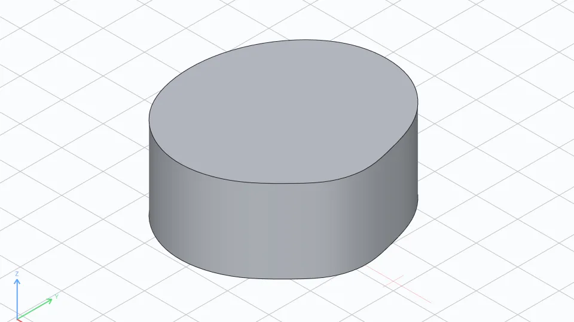

# Disc cam profile from a cycloidal motion law: base circle sized for pressure angle

[](https://runmat.com/sandbox?example=industrial-machinery-disc-cam)

`disc_cam.part` models a dwell-rise-dwell-return disc cam whose shape comes from its motion law.
Two MATLAB-language functions in the same folder size the base circle and give the pitch radius at
every 30° station, and the part draws a closed spline through those points and extrudes it. For 8 mm
of lift over a 150° rise with a 30° pressure-angle limit, the pitch-curve base radius is 6.586 mm and
the pitch radius reaches 14.586 mm at full lift.

<picture>
  <source media="(prefers-color-scheme: dark)" srcset=".artifacts/thumbnail.webp">
  
</picture>

## The problem

A disc cam turns shaft rotation into follower lift. Its profile is set by a motion law, the lift
`s` as a function of cam angle θ. This cam rises over 150°, dwells 30° at full lift, returns over
150° and dwells 30° on the base circle.

Rise and return use the cycloidal law, with u the fraction of the segment completed:

$$s(u) = h \left( u - \frac{\sin 2\pi u}{2\pi} \right)$$

Its velocity and acceleration are zero at both ends of each segment, so the follower sees no jerk
spike where the segments meet. That suits moderate-speed machinery where the follower spring has to
hold contact through the return.

The base circle sets the pressure angle φ, the angle between the follower's motion and the contact
normal. A large φ pushes the follower sideways in its guide. For a translating roller follower with
no offset, the cycloidal rise is steepest at mid-rise, where ds/dθ = 2h/β and s = h/2:

$$\tan \varphi = \frac{2h/\beta}{r_b + h/2}$$

Solving for the smallest base radius r_b that holds φ at its limit gives the cam's size. 30° is a
common limit for translating followers.

## How the example works

1. **Inputs.** The part declares the lift, the rise and dwell angles, the pressure-angle limit and
   the thickness:

   ```
   input lift : length = 8 mm
   input rise : angle = 150 deg
   input max_pressure : angle = 30 deg
   ```

2. **Base circle.** `camBaseRadius.m` solves the pressure-angle equation for r_b. Arguments arrive
   in SI units (m, rad):

   ```matlab
   rb = (2 * lift / rise) / tan(max_pressure) - lift / 2;
   ```

3. **Pitch radius at each station.** The part calls `camRadius.m` twelve times, at 0°, 30°, … 330°.
   The function picks the segment for θ and calls `cycloidal.m` for the rise and the return:

   ```
   let r60 = camRadius(theta = 60 deg, base = base, lift = input.lift, rise = input.rise, dwell = input.dwell) as m
   ```

4. **Profile and solid.** A closed spline through the points r(θ)·(cos θ, sin θ) forms the pitch
   curve, and `extrude` makes it 10 mm thick:

   ```
   feature disc = extrude(profile = sketch.profile, distance = input.thickness)
   ```

The part calls the functions by name, with no import line, because they sit in its folder. Each
value states the unit of the result with `as m`.

## Results

| Cam angle | Pitch radius |
| --- | --- |
| 0°, 330° | 6.586 mm |
| 30°, 300° | 6.975 mm |
| 60°, 270° | 9.037 mm |
| 90°, 240° | 12.134 mm |
| 120°, 210° | 14.196 mm |
| 150°, 180° | 14.586 mm |

The base radius is 6.586 mm, and the radius at full lift is that plus the 8 mm lift. The profile is
symmetric about the middle of the top dwell because the return mirrors the rise. The part models the
pitch curve: a real cam adds the roller radius and a hub bore.

In the Outline, a value marked ƒ was computed by MATLAB code. Select it to see the function and its
file in Properties.

## What to try

1. Change `lift` from 8 mm to 10 mm. The base radius grows to 8.232 mm to keep the pressure angle at
   30°, and the profile regenerates.
2. Lower `max_pressure` to 25 deg. At 8 mm of lift the base radius grows to 9.106 mm, so the cam
   gets larger for the same motion.
3. Edit `cycloidal.m` to another normalized motion law, such as a modified sine, and compare the lobe.
   `camBaseRadius.m` assumes the cycloidal peak slope, so update it to match.

## Files

- `disc_cam.part`: the cam's inputs, the values computed by the functions, the pitch-curve spline and the extrusion.
- `camBaseRadius.m`: the smallest base radius that keeps a cycloidal rise under the pressure-angle limit.
- `camRadius.m`: the pitch radius at a cam angle: cycloidal rise, dwell, cycloidal return, dwell.
- `cycloidal.m`: the normalized cycloidal motion law.
- `DESIGN-NOTES.md`: the design reasoning: motion law, base circle, station count and thickness.
- `runmat.toml`: the project file.

## Related

- [Industrial machinery in RunMat](https://runmat.com/industries/industrial-machinery)
- [RunMat MCAD](https://runmat.com/cad) and the [model a part guide](https://runmat.com/docs/mcad/guides/model-a-part)
- [`tan`](https://runmat.com/docs/reference/builtins/tan) and [`sin`](https://runmat.com/docs/reference/builtins/sin)
- [Shaft critical speed](../critical-speed) and [rotor dynamics](../rotor)
- [Download RunMat](https://runmat.com/download)
