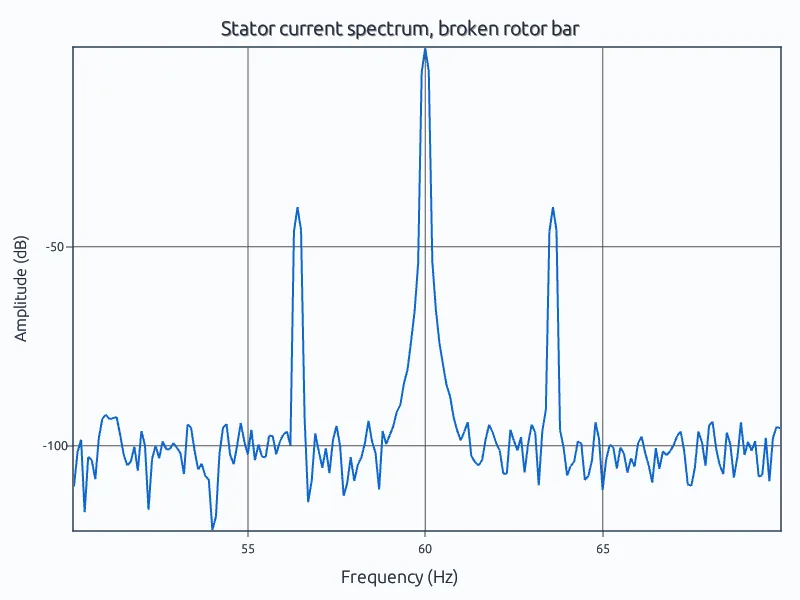

# Detecting a broken rotor bar from slip sidebands in motor current

[](https://runmat.com/sandbox?example=industrial-machinery-motor-current)

This example applies motor current signature analysis to a 4-pole, 60 Hz induction motor running at
3 % slip with a broken rotor bar. It computes the spectrum of 10 seconds of stator current and finds
the lower slip sideband at 56.40 Hz, exactly where (1 − 2s)f predicts it, 40 dB below the supply
line.

<picture>
  <source media="(prefers-color-scheme: dark)" srcset=".artifacts/thumbnail.webp">
  
</picture>

## The problem

A cracked or broken rotor bar in a squirrel-cage induction motor makes the rotor field asymmetric.
The asymmetry modulates the stator current at twice the slip frequency, so sidebands appear on both
sides of the supply frequency f:

$$f_{sb} = (1 \pm 2s) f$$

where s is the per-unit slip. Motor current signature analysis reads these sidebands from a
current clamp on one supply phase, with the motor running and no sensor on the machine itself.
The depth of the sidebands below the supply line indicates the severity: the smaller the gap in
dB, the more bars are damaged.

Here f = 60 Hz and s = 0.03, so the sidebands sit at 56.4 Hz and 63.6 Hz.

## How the example works

1. **Make the current signal**: a 60 Hz sine, amplitude-modulated by 2 % at 2sf = 3.6 Hz, with a
   little noise, sampled at 5 kHz for 10 s:

   ```matlab
   i = sin(2*pi*f*t) .* (1 + 0.02*cos(2*pi*2*s*f*t)) + 0.001*randn(size(t));
   ```

2. **Window and transform.** A Hann window keeps the strong supply line from leaking over the
   sidebands, and the scaling `2*abs(fft(...))/sum(w)` gives amplitudes in dB relative to a unit
   sine:

   ```matlab
   w = hann(numel(i));
   P = 20*log10(2*abs(fft(i .* w)) / sum(w));
   ```

3. **Find the lower sideband** as the largest bin between 55 and 57 Hz. The 10-second record gives
   a 0.1 Hz resolution, fine enough to separate the sideband from the supply line.

4. **Plot the spectrum** from 50 to 70 Hz.

## Results

```
lower sideband at 56.40 Hz, expected 56.40 Hz from the slip
40 dB below the supply line
```

The plot shows the supply line at 60 Hz and two sidebands at the same height, 56.4 Hz and
63.6 Hz, above a noise floor near −100 dB. A 2 % amplitude modulation puts 1 % of the supply
amplitude in each sideband, which is 20·log₁₀(0.01) = −40 dB, matching the measured gap.

## What to try

1. Change the slip to `s = 0.01`. The sidebands move to 58.8 Hz and 61.2 Hz, and the search band
   `k1`, `k2` has to move with them.
2. Shorten the record to `t = (0:1/fs:1)'`. The resolution coarsens to 1 Hz; look at whether the
   sidebands still separate from the Hann window's main lobe around 60 Hz.
3. Halve the modulation depth to `0.01`. Each sideband drops to 0.5 % of the supply amplitude, 46 dB
   below the line.

## Files

- `motor-current.m`: the script: current signal, windowed spectrum, sideband search and the plot.
- `runmat.toml`: the project file.

## Related

- [Industrial machinery in RunMat](https://runmat.com/industries/industrial-machinery)
- [Bearing fault in an envelope spectrum](../bearing-envelope): a bearing defect found at its defect frequency
- Function reference: [`hann`](https://runmat.com/docs/reference/builtins/hann), [`fft`](https://runmat.com/docs/reference/builtins/fft), [`max`](https://runmat.com/docs/reference/builtins/max)
- [Download RunMat](https://runmat.com/download)
