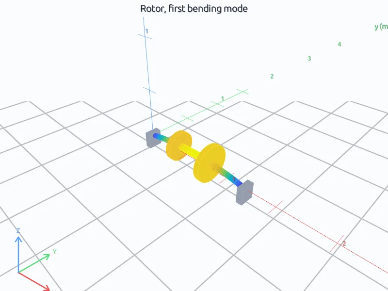

# Rotor first bending mode and critical speed margin from a beam model

[](https://runmat.com/sandbox?example=industrial-machinery-rotor)

This example computes the first bending mode of a stepped steel shaft on two bearings 1.2 m apart,
carrying a 25 kg and a 40 kg disc, and draws the rotor to scale in 3-D, colored by the mode's
deflection. The first critical speed is 2561 rpm, 42 % above a 1,800 rpm running speed.

<picture>
  <source media="(prefers-color-scheme: dark)" srcset=".artifacts/thumbnail.webp">
  
</picture>

## The problem

A rotor running near its first bending frequency whirls with large amplitude, loads its bearings
and can rub its seals. Designers keep the first critical speed a set margin away from the
operating speed, with the margin taken from the machine's design standard. The check needs the
rotor's first natural frequency, and the mode shape shows where the shaft bends most and how much
each disc moves with it.

The shaft is 50 mm in diameter, stepping up to 70 mm between 0.3 m and 0.9 m, in steel with
E = 210 GPa and ρ = 7850 kg/m³. The discs sit at 0.4 m and 0.8 m with radii of 147 mm and 183 mm.
The bearings are modeled as simple supports.

## How the example works

1. **Assemble the beam model**: 48 Euler-Bernoulli elements with stiffness and consistent mass
   matrices, two degrees of freedom (deflection and slope) per node.

2. **Add the discs** as point masses at their nodes and pin the two bearing nodes:

   ```matlab
   M(r, r) = M(r, r) + discs(j, 2);
   free = setdiff((1:2*ne + 2)', [1; 2*ne + 1]);
   ```

3. **Solve the eigenproblem** and keep the lowest mode, normalized to a peak deflection of 1:

   ```matlab
   [Phi, Lam] = eig(K(free, free), M(free, free));
   [w2, first] = min(diag(Lam));
   crit = sqrt(w2) * 60 / (2*pi);
   ```

4. **Draw the rotor.** Each element becomes a ring of `patch` faces, displaced by the mode shape
   and colored from `parula` by its deflection. The discs are short drums, and the bearings are
   grey blocks.

## Results

```
first critical speed 2561 rpm
42% above a 1,800 rpm running speed
```

The figure shows the shaft bowed between the bearings: the discs and the middle of the span move
most (yellow), and the color falls to zero (blue) at both bearings, which the model holds fixed.
The deflection is scaled by `amp = 0.06` to make it visible. The model treats the bearings as rigid
and leaves out gyroscopic effects, so the 42 % margin applies to this simply supported shaft.

## What to try

1. Raise the running speed in the margin line from 1,800 to 2,400 rpm. The margin falls to 7 %.
2. Increase the larger disc to 80 kg in `discs` and check how far the critical speed falls.
3. Move the 40 kg disc to mid-span by changing its position in `discs` from 0.8 to 0.6, and watch
   where the yellow band sits in the figure.

## Files

- `rotor.m`: the script: beam model, first mode, critical speed margin and the 3-D drawing.
- `runmat.toml`: the project file.

## Related

- [Industrial machinery in RunMat](https://runmat.com/industries/industrial-machinery)
- [Shaft critical speed three ways](../critical-speed): the same shaft checked with Dunkerley's and Rayleigh's methods
- [NREL 5-MW tower mode shape](../../energy/turbine): a beam mode drawn on a structure
- Function reference: [`eig`](https://runmat.com/docs/reference/builtins/eig), [`patch`](https://runmat.com/docs/reference/builtins/patch), [`parula`](https://runmat.com/docs/reference/builtins/parula)
- [Download RunMat](https://runmat.com/download)
