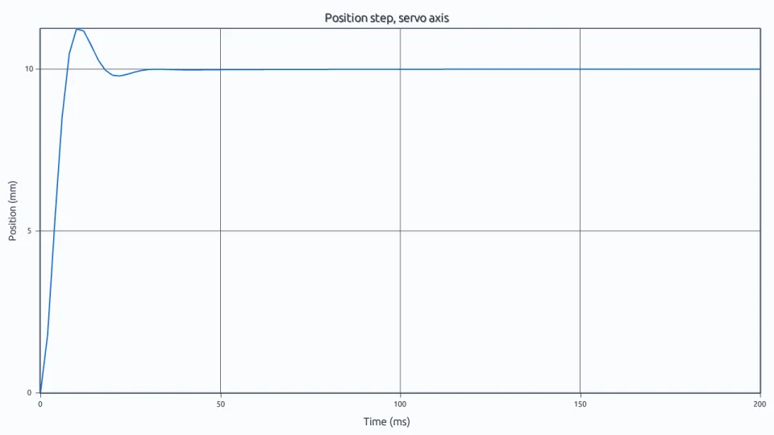

# Tuning a cascaded servo axis: step response of a P position loop over a PI velocity loop

[](https://runmat.com/sandbox?example=industrial-machinery-servo-axis)

This example models a linear axis driven by a servo motor, with a PI velocity loop inside a
proportional position loop, and simulates a 10 mm position step. With the gains from a first tuning
pass, the axis overshoots by 12.4 % and stays within 0.1 mm of the target after 26 ms.

<picture>
  <source media="(prefers-color-scheme: dark)" srcset=".artifacts/thumbnail.webp">
  
</picture>

## The problem

Machine tool and automation axes almost always use cascaded control. An inner velocity loop, fast
and with integral action, makes the motor follow a speed command and rejects friction and load
torque. An outer position loop turns position error into that speed command. Commissioning tunes
the inner loop first, then raises the position gain until the step response shows the overshoot
the application allows. Overshoot on a machining axis cuts into the part, so the target is often
a few percent or none.

The mechanics here are the inertia and viscous damping of the axis, referred to the motor:

$$G(s) = \frac{1}{J s + b}, \qquad J = 2 \times 10^{-3}\ \text{kg m}^2, \quad b = 10^{-3}\ \text{N m s}$$

The velocity controller is $K_v + K_i/s$ with $K_v = 0.8$ and $K_i = 20$, and the position
controller is a gain $K_p = 300\ \text{s}^{-1}$.

## How the example works

1. **Build the plant** as a transfer function:

   ```matlab
   s = tf('s');
   plant = 1 / (J*s + b);
   ```

2. **Close the velocity loop** around the plant with the PI controller:

   ```matlab
   velocity = feedback((Kv + Ki/s) * plant, 1);
   ```

3. **Close the position loop.** The integrator `1/s` turns velocity into position:

   ```matlab
   position = feedback(Kp * velocity / s, 1);
   ```

4. **Simulate the step** for 0.2 s, then read the overshoot and the last time the error exceeds
   0.1 mm:

   ```matlab
   [y, t] = step(10 * position, 0.2);
   ```

## Results

```
overshoot 12.4% on a 10 mm step
within 0.1 mm of target after 26 ms
```

The plot shows the axis reaching 10 mm in under 10 ms, peaking above 11 mm, dipping once below
10 mm and then holding the target. The 1.24 mm overshoot is what a second tuning pass would reduce,
either by lowering the position gain or by stiffening the velocity loop.

## What to try

1. Lower the position gain to `Kp = 200`. A fine-step simulation of the same loop puts the overshoot
   at 5.5 %, against 12.7 % for `Kp = 300`. The script's 12.4 % reads the peak at the time points
   `step` returns, which fall slightly to either side of the true peak.
2. Stiffen the velocity loop instead, with `Kv = 1.2`. The same simulation gives 5.0 % overshoot and
   settling within 0.1 mm after 15 ms, faster than the original.
3. Double the load inertia, `J = 4e-3`, without retuning, and see how the overshoot changes.

## Files

- `servo-axis.m`: the script: plant, velocity and position loops, step response and the plot.
- `runmat.toml`: the project file.

## Related

- [Industrial machinery in RunMat](https://runmat.com/industries/industrial-machinery)
- [Milling stability lobes](../stability-lobes): the dynamics of the cut on the same kind of machine
- Function reference: [`tf`](https://runmat.com/docs/reference/builtins/tf), [`feedback`](https://runmat.com/docs/reference/builtins/feedback), [`step`](https://runmat.com/docs/reference/builtins/step)
- [Download RunMat](https://runmat.com/download)
