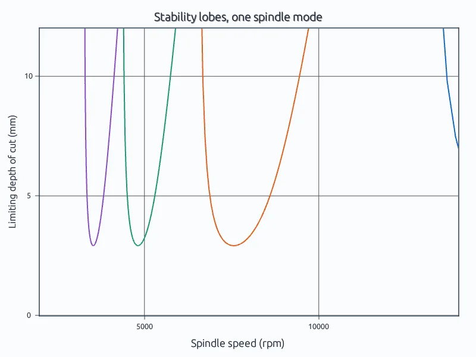

# Milling stability lobe diagram: chatter-free depth of cut against spindle speed

[](https://runmat.com/sandbox?example=industrial-machinery-stability-lobes)

This example computes the stability lobe diagram for a three-tooth milling cutter on a spindle with
one dominant mode at 650 Hz, 2 % damping and 50 N/µm stiffness. Below a 2.91 mm axial depth of cut
the process is stable at every spindle speed. Above it, stability depends on speed, and the widest
stable pocket opens near 13,000 rpm, where the tooth-passing frequency matches the mode.

<picture>
  <source media="(prefers-color-scheme: dark)" srcset=".artifacts/thumbnail.webp">
  
</picture>

## The problem

Chatter is a self-excited vibration in machining. Each tooth cuts the wavy surface left by the
previous one, and when the phase between the old and new waves is wrong, the vibration grows. It
ruins the surface finish and can break the tool. The limiting depth of cut depends on the
spindle's frequency response at the tool tip and on the spindle speed, which sets the time between
teeth.

The single-mode model in Schmitz and Smith, *Machining Dynamics*, gives the limiting axial depth
from the real part of the tool-point frequency response function G at a chatter frequency f_c:

$$b_{lim} = \frac{-1}{2 K_s \, \text{Re}[G(f_c)]}, \qquad G = \frac{1}{k \left(1 - r^2 + 2 i \zeta r\right)}, \quad r = \frac{f_c}{f_n}$$

Only frequencies above f_n, where Re G is negative, give a positive depth. The spindle speed that
places chatter at f_c on lobe N is

$$\Omega = \frac{60 f_c}{N_t \left(N + \varepsilon / 2\pi\right)}, \qquad \varepsilon = 2\pi - 2 \arctan\frac{\text{Re}\,G}{\text{Im}\,G}$$

where ε is the phase between successive tooth passes and N_t = 3 is the number of teeth. The
cutting stiffness K_s = 700 N/mm² describes the work material.

## How the example works

1. **Sweep the chatter frequency** from 1.001 to 1.5 times the natural frequency and evaluate the
   frequency response:

   ```matlab
   fc = linspace(1.001, 1.5, 500)' * fn;
   G = 1 ./ (k * (1 - r.^2 + 2i*zeta*r));
   ```

2. **Compute the limiting depth** and the phase at each frequency:

   ```matlab
   blim = -1 ./ (2*Ks*re);
   eps = 2*pi - 2*atan(re ./ im);
   ```

3. **Map each frequency to a spindle speed** on lobes N = 0 to 3:

   ```matlab
   rpm(:, lobe + 1) = 60 * fc ./ (N * (lobe + eps/(2*pi)));
   ```

4. **Plot the lobes** from 2,000 to 14,000 rpm and 0 to 12 mm.

## Results

```
stable at any speed below 2.91 mm depth of cut
the first lobe peaks near 13223 rpm
```

The 2.91 mm floor matches the closed form for one mode, 2kζ(1 + ζ)/K_s. The second line labels
its value loosely: 13,223 rpm is the speed at which the N = 0 lobe begins, at the lowest chatter
frequency in the sweep (1.001 f_n), where its limiting depth is 28.7 mm. In the figure, that lobe
enters from the top at 13,223 rpm and falls toward the right edge. Between it and the N = 1 lobe lies the widest stable pocket,
around the speed where three teeth pass at 650 Hz, 60 · 650 / 3 = 13,000 rpm.

In the figure, the lobes for N = 1, 2 and 3 bottom out at 2.91 mm near 7,562, 4,815 and 3,532 rpm.
Between their bottoms, the stable depth rises well above 12 mm. A process engineer picks a speed in
one of these pockets to cut deeper than the 2.91 mm floor.

## What to try

1. Double the damping to `zeta = 0.04`. The closed form puts the floor at 5.94 mm.
2. Switch to a four-tooth cutter, `N = 4`. Every lobe moves to three-quarters of its speed, so the
   widest pocket moves to 60 · 650 / 4 = 9,750 rpm.
3. Extend the sweep to `linspace(1.001, 3, 500)'` and see where the lobes cross at the top of the
   pockets.

## Files

- `stability-lobes.m`: the script: frequency response, limiting depth, lobe speeds and the plot.
- `runmat.toml`: the project file.

## Related

- [Industrial machinery in RunMat](https://runmat.com/industries/industrial-machinery)
- [Servo axis tuning](../servo-axis): position control on the same kind of machine
- Function reference: [`linspace`](https://runmat.com/docs/reference/builtins/linspace), [`atan`](https://runmat.com/docs/reference/builtins/atan), [`plot`](https://runmat.com/docs/reference/builtins/plot)
- [Download RunMat](https://runmat.com/download)
