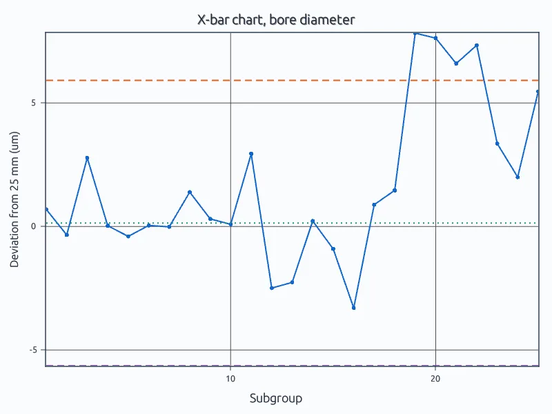

# X-bar control chart for a machined bore diameter: detecting a process shift

[](https://runmat.com/sandbox?example=industrial-machinery-xbar-chart)

This example builds a Shewhart X-bar chart for a 25 mm bore diameter from 25 subgroups of 5 parts.
The control limits come from the first 15 subgroups, 24.9939 mm to 25.0055 mm. A 6 µm shift in the
process starts at subgroup 18, and the chart flags subgroup 18 as the first one out of control.

<picture>
  <source media="(prefers-color-scheme: dark)" srcset=".artifacts/thumbnail.webp">
  
</picture>

## The problem

Statistical process control watches a production process for changes in its mean before parts go
out of tolerance. An X-bar chart plots the mean of each small subgroup of parts. While the process
runs as it did when the limits were set, the means scatter around the center line inside the
control limits. A point outside the limits signals a special cause, such as tool wear, a new batch
of material or a fixture moved by a crash, and the operator stops to look for it.

The limits are set from a period of stable production, using the average subgroup range R̄ as the
measure of spread:

$$\text{UCL}, \text{LCL} = \bar{\bar{x}} \pm A_2 \bar{R}$$

For subgroups of 5, the tabulated constant A₂ is 0.577, which places the limits three standard
errors of the subgroup mean from the center line.

## How the example works

1. **Simulate the measurements**: 25 subgroups of 5 bores with a 4 µm standard deviation, and a
   6 µm shift from subgroup 18 on. `rng(4)` fixes the random numbers so the run repeats:

   ```matlab
   rng(4);
   bore = 25.000 + 0.004*randn(25, 5);
   bore(18:25, :) = bore(18:25, :) + 0.006;
   ```

2. **Compute each subgroup's mean and range**:

   ```matlab
   xbar = mean(bore, 2);  range = max(bore, [], 2) - min(bore, [], 2);
   ```

3. **Set the limits from the first 15 subgroups** only, the period before the shift:

   ```matlab
   center = mean(xbar(1:15));  Rbar = mean(range(1:15));
   ucl = center + A2*Rbar;  lcl = center - A2*Rbar;
   ```

4. **Flag and plot.** `find` lists the subgroups outside the limits, and the chart shows the means
   as deviations from 25 mm in micrometers, with dashed control limits and a dotted center line.

## Results

```
control limits 24.9939 to 25.0055 mm
first subgroup out of control: 18 of 25
```

The center line sits at 24.9997 mm, midway between the limits. A 6 µm shift is 1.5 standard
deviations of a single bore, but 3.35 standard errors of a mean of 5, which is why the chart
catches it on the first shifted subgroup. In the figure, six of the eight shifted subgroups plot
above the upper limit; subgroups 20 and 24 fall inside it.

## What to try

1. Shrink the shift to `0.003` and see how many subgroups pass before the first signal.
2. Change `rng(4)` to another seed. The limits and the points move, and the first signal may come
   later than subgroup 18.
3. Set the limits from all 25 subgroups, `xbar(1:25)` and `range(1:25)`. The ranges hardly change,
   because the shift moves all five parts of a subgroup alike, but the center line rises toward the
   shifted data. Count how many points still cross a limit.

## Files

- `xbar-chart.m`: the script: simulated bore measurements, control limits, out-of-control check and the chart.
- `runmat.toml`: the project file.

## Related

- [Industrial machinery in RunMat](https://runmat.com/industries/industrial-machinery)
- [Milling stability lobes](../stability-lobes): another machining process check
- Function reference: [`rng`](https://runmat.com/docs/reference/builtins/rng), [`mean`](https://runmat.com/docs/reference/builtins/mean), [`max`](https://runmat.com/docs/reference/builtins/max)
- [Download RunMat](https://runmat.com/download)
