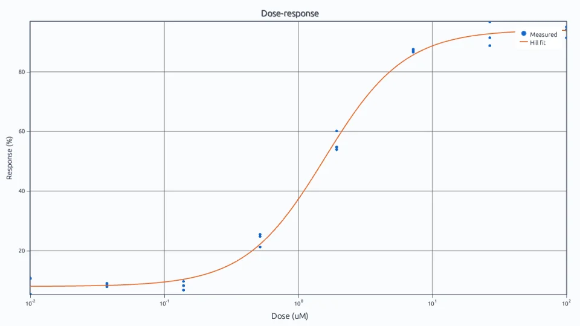

# Fitting a four-parameter Hill curve to dose-response data: EC50 and Hill slope

[](https://runmat.com/sandbox?example=life-sciences-dose-response)

This example fits a four-parameter logistic (Hill) curve to a dose-response assay with eight doses
from 0.01 to 100 µM, each measured in triplicate, by nonlinear least squares. The fit gives an EC50
of 1.57 µM and a Hill slope of 1.46, against the 1.80 µM and 1.30 used to generate the data with
4 % measurement noise.

<picture>
  <source media="(prefers-color-scheme: dark)" srcset=".artifacts/thumbnail.webp">
  
</picture>

## The problem

Pharmacology and assay development summarize a compound's potency with a dose-response curve. The
response rises from a bottom plateau to a top plateau along a sigmoid in log dose, and the
four-parameter Hill equation describes it:

$$y(x) = \text{bottom} + \frac{\text{top} - \text{bottom}}{1 + \left(\text{EC}_{50} / x\right)^{h}}$$

EC50 is the dose that gives half the maximal effect, the usual measure of potency. The Hill slope h
sets how steep the transition is; h = 1 matches simple one-to-one binding, and larger values mean
a steeper, more switch-like response. Bottom and top are the plateaus, in percent of the maximal
response. Comparing EC50 values between compounds or batches needs a fit that estimates all four
together, because a misplaced plateau shifts the midpoint.

## How the example works

1. **Make the doses**: eight log-spaced doses, each repeated three times.

   ```matlab
   dose = repmat(logspace(-2, 2, 8), 3, 1);  dose = dose(:);
   ```

2. **Define the model** as an anonymous function of the parameter vector
   `p = [bottom top EC50 h]`, and generate responses from `truth = [5 95 1.8 1.3]` with Gaussian
   noise of 4 % standard deviation. `rng(9)` fixes the noise so the run repeats:

   ```matlab
   hill = @(p, x) p(1) + (p(2) - p(1)) ./ (1 + (p(3) ./ x).^p(4));
   resp = hill(truth, dose) + 4*randn(size(dose));
   ```

3. **Fit** with `lsqcurvefit`, starting from 0 % to 100 % response, EC50 of 1 µM and slope 1:

   ```matlab
   p = lsqcurvefit(hill, [0 100 1 1], dose, resp);
   ```

4. **Plot** the 24 measurements and the fitted curve on a logarithmic dose axis.

## Results

```
EC50 1.57 uM (true 1.80), Hill slope 1.46 (true 1.30)
bottom 8.0%, top 94.1% response
```

The fitted EC50 is 13 % below the true value, and the slope is 12 % steeper. With eight doses
spaced a factor of 3.7 apart, only three of them, 0.52, 1.93 and 7.20 µM, fall on the rising part
of the curve, so the noise on those nine points carries most of the information about EC50 and
slope. The bottom plateau, 8.0 % against 5 %, has the largest relative error, because the 4 %
noise is close to the size of the plateau itself.

## What to try

1. Lower the noise to `1*randn(size(dose))` and see how close the fitted EC50 and slope come to
   the true values.
2. Use 16 doses, `logspace(-2, 2, 16)`, to put more points on the transition.
3. Change `rng(9)` to other seeds and record the fitted EC50 each time, a quick way to see the
   spread of the estimate at this noise level.

## Files

- `dose-response.m`: the script: simulated assay, Hill model, least-squares fit and the plot.
- `runmat.toml`: the project file.

## Related

- [Life sciences in RunMat](https://runmat.com/industries/life-sciences)
- [Drug concentration under repeated dosing](../pk-dosing): what concentration a dosing schedule reaches
- Function reference: [`lsqcurvefit`](https://runmat.com/docs/reference/builtins/lsqcurvefit), [`logspace`](https://runmat.com/docs/reference/builtins/logspace), [`semilogx`](https://runmat.com/docs/reference/builtins/semilogx)
- [Download RunMat](https://runmat.com/download)
