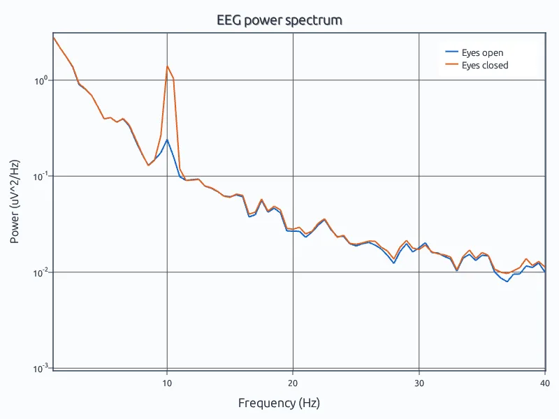

# EEG alpha band power with eyes open and closed using Welch's method

[](https://runmat.com/sandbox?example=life-sciences-eeg-alpha)

This example estimates the power spectrum of one EEG channel in two 60-second recordings, eyes open
and eyes closed, with Welch's method, and integrates the power in the 8–12 Hz alpha band. Closing
the eyes raises alpha power 2.9 times, with the spectral peak at 10.0 Hz.

<picture>
  <source media="(prefers-color-scheme: dark)" srcset=".artifacts/thumbnail.webp">
  
</picture>

## The problem

The alpha rhythm, at about 8–12 Hz over the back of the head, is the most visible feature of the
resting EEG. It grows when a person closes their eyes and shrinks when they open them or attend to
something, an effect known as alpha blocking. The eyes-closed to eyes-open ratio is a standard
check of a recording setup and a common feature in neurofeedback, sleep and brain-computer
interface work.

Band power is the area under the power spectral density (PSD) across the band:

$$P_\alpha = \int_{8}^{12} S(f) \, df$$

A single FFT of a noisy signal gives a PSD with large variance at each frequency. Welch's method
splits the record into overlapping windowed segments and averages their periodograms, trading
frequency resolution for a smoother estimate.

## How the example works

1. **Simulate the two recordings** at 256 Hz for 60 s. Both share the same background, white noise
   through a one-pole filter, which gives the falling 1/f-like spectrum of the EEG. A 10.2 Hz
   rhythm with phase jitter rides on top, with amplitude 0.4 eyes open and 1.6 eyes closed:

   ```matlab
   pink = filter(1, [1 -0.95], randn(n, 1));
   open_eeg = pink + 0.4*sin(2*pi*10.2*t + 0.3*randn(n, 1));
   closed_eeg = pink + 1.6*sin(2*pi*10.2*t + 0.3*randn(n, 1));
   ```

2. **Estimate each PSD** with 512-sample (2 s) Hann windows and 50 % overlap, which gives a 0.5 Hz
   frequency resolution:

   ```matlab
   [po, f] = pwelch(open_eeg, hann(512), 256, 512, fs);
   ```

3. **Integrate the alpha band** with the trapezoidal rule and take the ratio:

   ```matlab
   band = f >= 8 & f <= 12;
   ao = trapz(f(band), po(band));  ac = trapz(f(band), pc(band));
   ```

4. **Plot both spectra** from 1 to 40 Hz on a logarithmic power axis.

## Results

```
alpha power 2.9 times higher with eyes closed
alpha peak at 10.0 Hz
```

The two spectra lie on top of each other everywhere except around 10 Hz, where the eyes-closed
peak stands well above the eyes-open one. The 10.2 Hz rhythm falls in the 10.0 Hz bin of the
0.5 Hz grid. The rhythm's amplitude grows four times, a 16-fold power increase, but the band
power grows only 2.9 times, because the shared background contributes the same power to the
8–12 Hz band in both recordings.

## What to try

1. Narrow the band to 9.5–10.5 Hz, where the rhythm dominates the background, and compare the
   ratio with the rhythm's own 16-fold power increase.
2. Use 1024-sample windows, `hann(1024)`, `512` overlap and `1024` points, for a 0.25 Hz grid that
   resolves the 10.2 Hz rhythm more closely.
3. Replace the simulated signals with a real recording: load one channel into `open_eeg` and
   `closed_eeg` and set `fs` to its sample rate.

## Files

- `eeg-alpha.m`: the script: simulated recordings, Welch spectra, alpha band power and the plot.
- `runmat.toml`: the project file.

## Related

- [Life sciences in RunMat](https://runmat.com/industries/life-sciences)
- [Heart-rate variability from an ECG](../hrv-ecg): another physiological signal measured from a simulated recording
- Function reference: [`pwelch`](https://runmat.com/docs/reference/builtins/pwelch), [`trapz`](https://runmat.com/docs/reference/builtins/trapz), [`filter`](https://runmat.com/docs/reference/builtins/filter), [`semilogy`](https://runmat.com/docs/reference/builtins/semilogy)
- [Download RunMat](https://runmat.com/download)
