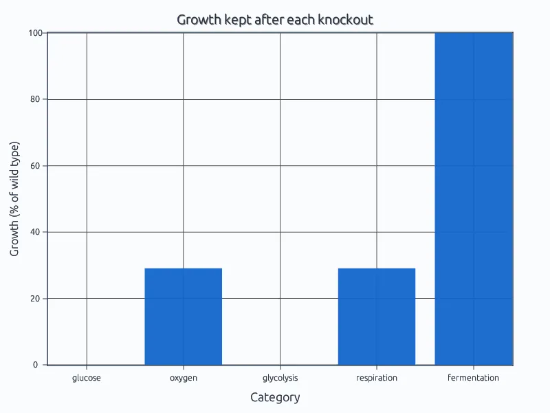

# Flux balance analysis and single-reaction knockouts with linear programming

[](https://runmat.com/sandbox?example=life-sciences-fba-knockout)

This example runs flux balance analysis (FBA) on a six-reaction model of central metabolism and
then knocks out each of five reactions in turn. The wild-type cell grows at 12.50 per hour. Without
respiration it keeps 29 % of that growth by fermenting, and without glucose uptake it does not grow
at all.

<picture>
  <source media="(prefers-color-scheme: dark)" srcset=".artifacts/thumbnail.webp">
  
</picture>

## The problem

Metabolic engineers and microbiologists use FBA to predict how fast a cell can grow on a given
medium and which genes it cannot do without. FBA needs no kinetic parameters. It assumes steady
state, so every internal metabolite is produced as fast as it is consumed, and picks the reaction
fluxes v that maximize a biomass reaction within bounds on uptake:

$$\max_v \; v_{\text{biomass}} \quad \text{subject to} \quad S v = 0, \quad lb \le v \le ub$$

S is the stoichiometric matrix, one row per metabolite and one column per reaction. A gene
knockout sets the flux of its reaction to zero. If growth drops to zero, the reaction is essential.

This network has four metabolites and six reactions:

| Reaction | Converts | Bound |
| --- | --- | --- |
| 1 glucose uptake | → glucose | ≤ 10 |
| 2 oxygen uptake | → oxygen | ≤ 20 |
| 3 glycolysis | glucose → 2 pyruvate + 2 ATP | |
| 4 respiration | oxygen + pyruvate → 14 ATP | |
| 5 fermentation | pyruvate → 1 ATP | |
| 6 biomass | pyruvate + 10 ATP → biomass | |

## How the example works

1. **Write the stoichiometric matrix**, rows glucose, oxygen, pyruvate and ATP:

   ```matlab
   S = [ 1  0 -1  0  0   0;
         0  1  0 -1  0   0;
         0  0  2 -1 -1  -1;
         0  0  2 14  1 -10];
   ```

2. **Maximize biomass** with `linprog`, which minimizes, so the objective is −v₆:

   ```matlab
   c = [0 0 0 0 0 -1]';
   [~, fval] = linprog(c, [], [], S, zeros(4, 1), lb, ub);
   ```

3. **Knock out each reaction** by setting its upper bound to zero and solving again, then express
   the growth as a percentage of the wild type:

   ```matlab
   ko = ub;  ko(r) = 0;
   kept(r) = 100 * max(0, -fk) / wild;
   ```

4. **Plot** the growth kept after each knockout as a bar chart.

## Results

```
wild-type growth 12.50 per hour
growth: 29% without respiration, 0% without glucose
```

The wild type is limited by glucose. Glycolysis turns the 10 units of glucose into 20 of pyruvate
and 20 of ATP, and the optimum respires 7.5 units of pyruvate for 105 ATP and sends the remaining
12.5 to biomass, which needs 125 ATP. Oxygen uptake runs at 7.5 of its 20 limit.

The bar chart shows three groups. Glucose uptake and glycolysis are essential: without them there
is no pyruvate. Oxygen uptake and respiration give the same result, 29 % growth, because blocking
either one stops respiration and leaves fermentation's 1 ATP per pyruvate. Fermentation can go
with no loss, because the optimum never uses it.

## What to try

1. Limit oxygen to 5 in `ub`. Respiration is capped at 5, fermentation makes up the ATP, and growth
   falls to 9.55 per hour.
2. Double the glucose limit to 20. Oxygen still does not bind, so every flux doubles and growth
   reaches 25.00 per hour.
3. Add a reaction column to `S`, for example a second ATP-producing route, extend `c`, `lb` and
   `ub`, and see which knockouts it rescues.

## Files

- `fba-knockout.m`: the script: stoichiometric matrix, wild-type FBA, single knockouts and the bar chart.
- `runmat.toml`: the project file.

## Related

- [Life sciences in RunMat](https://runmat.com/industries/life-sciences)
- [Dose-response fit](../dose-response): fitting a model to assay data
- Function reference: [`linprog`](https://runmat.com/docs/reference/builtins/linprog), [`bar`](https://runmat.com/docs/reference/builtins/bar)
- [Download RunMat](https://runmat.com/download)
