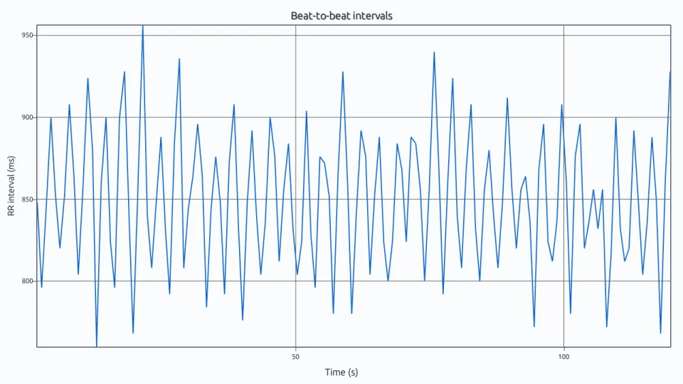

# Heart-rate variability from an ECG: R-peak detection, SDNN and RMSSD

[](https://runmat.com/sandbox?example=life-sciences-hrv-ecg)

This example detects the R peaks in two minutes of ECG sampled at 250 Hz, takes the beat-to-beat
(RR) intervals, and computes two standard time-domain heart-rate variability (HRV) measures. It
finds 141 beats at a mean rate of 70.6 per minute, an SDNN of 41.5 ms and an RMSSD of 58.4 ms.

<picture>
  <source media="(prefers-color-scheme: dark)" srcset=".artifacts/thumbnail.webp">
  
</picture>

## The problem

The interval between heartbeats varies from beat to beat. Breathing, blood pressure regulation and
the balance of the two branches of the autonomic nervous system all modulate it, so HRV is used in
cardiology, sleep and stress research, and wearable fitness devices. The analysis starts from the
ECG: locate each R peak, the tall spike of ventricular depolarization, and take the intervals
between successive peaks. Two time-domain measures summarize the intervals:

$$\text{SDNN} = \operatorname{std}(RR_i), \qquad \text{RMSSD} = \sqrt{\frac{1}{N-1}\sum_{i} \left(RR_{i+1} - RR_i\right)^2}$$

SDNN measures overall variability. RMSSD measures beat-to-beat change and mainly reflects fast,
vagally driven variation such as the breathing rhythm.

## How the example works

1. **Simulate the RR intervals and the ECG.** Each interval is 850 ms plus a 50 ms sinusoid and
   20 ms of random variation, and each beat is a narrow Gaussian spike in noise:

   ```matlab
   rr = 0.85 + 0.05*sin(2*pi*0.25*(1:200)') + 0.02*randn(200, 1);
   ecg = ecg + exp(-((t - beats(k))/0.012).^2);
   ```

   The sinusoid stands in for breathing. It advances 0.25 cycle per beat, so it repeats every four
   beats, about every 3.4 s at the mean interval. That is 17.6 breaths per minute, a little faster
   than the 15 per minute the script's header comment states.

2. **Detect the R peaks** as local maxima above 0.6, keeping only peaks at least 0.3 s after the
   previous one so that noise on a peak is not counted twice:

   ```matlab
   cand = find(mid > ecg(1:end-2) & mid >= ecg(3:end) & mid > 0.6) + 1;
   ```

3. **Compute the measures** from the intervals:

   ```matlab
   nn = diff(r);
   fprintf('SDNN %.1f ms, RMSSD %.1f ms\n', 1000*std(nn), 1000*rms(diff(nn)));
   ```

4. **Plot the RR intervals** against time.

## Results

```
141 beats, mean heart rate 70.6 per minute
SDNN 41.5 ms, RMSSD 58.4 ms
```

The mean rate matches the 850 ms mean interval, 60/0.85 = 70.6 per minute. The plot shows the RR
interval alternating around 850 ms with a four-beat rhythm. The values also match what
the simulated intervals predict: the sinusoid and the noise give a standard deviation of 40.6 ms,
and successive differences of 57.4 ms RMS. RMSSD comes out larger than SDNN because the modulation
is fast; a quarter cycle per beat makes neighboring intervals differ by the full 50 ms amplitude.

## What to try

1. Slow the breathing to `0.1` cycle per beat, 7.1 breaths per minute at this heart rate.
   Neighboring intervals then differ less: the simulated intervals' expected RMSSD drops to 35.7 ms,
   while their expected SDNN stays at 40.6 ms.
2. Raise the ECG noise from `0.05` to `0.3` and look for missed or extra beats in the beat count.
3. Compute a frequency-domain measure: resample the RR series at 4 Hz with `interp1` and find its
   power in the 0.15–0.4 Hz high-frequency band.

## Files

- `hrv-ecg.m`: the script: simulated ECG, R-peak detection, SDNN, RMSSD and the plot.
- `runmat.toml`: the project file.

## Related

- [Life sciences in RunMat](https://runmat.com/industries/life-sciences)
- [Wearable skin temperature](../wearable-temperature) and [EEG alpha power](../eeg-alpha): other physiological signals
- Function reference: [`diff`](https://runmat.com/docs/reference/builtins/diff), [`std`](https://runmat.com/docs/reference/builtins/std), [`rms`](https://runmat.com/docs/reference/builtins/rms), [`find`](https://runmat.com/docs/reference/builtins/find)
- [Download RunMat](https://runmat.com/download)
