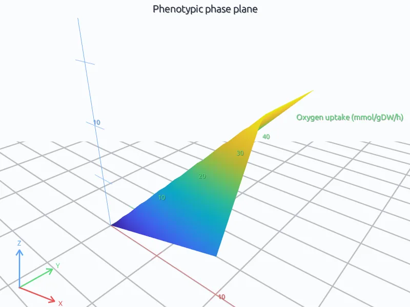

# Phenotypic phase plane: growth rate over glucose and oxygen uptake by flux balance analysis

[](https://runmat.com/sandbox?example=life-sciences-phase-plane)

This example maps the best growth rate of a small metabolic network over a 21 × 21 grid of glucose
and oxygen uptake limits, solving one flux balance linear program at each of the 441 points. At the
highest limits, 10 mmol/gDW/h glucose and 20 mmol/gDW/h oxygen, the cell grows at 12.50 per hour.
With no oxygen at the same glucose limit it can only ferment and grows at 3.64 per hour.

<picture>
  <source media="(prefers-color-scheme: dark)" srcset=".artifacts/thumbnail.webp">
  
</picture>

## The problem

A phenotypic phase plane shows how the best achievable growth of a cell depends on two nutrient
uptake rates. It divides the plane into regions where different nutrients limit growth, which
tells a bioprocess engineer whether to feed more substrate or supply more oxygen, and where the
cell switches between respiration and fermentation.

Each point is a flux balance analysis (FBA) problem: maximize the biomass flux subject to steady
state, S v = 0, and to the two uptake limits. The network has four metabolites and six reactions:
glucose and oxygen uptake, glycolysis (glucose → 2 pyruvate + 2 ATP), respiration (oxygen +
pyruvate → 14 ATP), fermentation (pyruvate → 1 ATP), and biomass (pyruvate + 10 ATP → biomass).

For this network the optimum has a closed form. With glucose limit g and oxygen limit o, the best
growth is

$$\mu = \begin{cases} \dfrac{4g + 13o}{11}, & o < 0.75\,g \quad \text{(oxygen-limited)} \\[1ex] 1.25\,g, & o \ge 0.75\,g \quad \text{(glucose-limited)} \end{cases}$$

Below the line o = 0.75 g the cell respires all the oxygen it gets and ferments the rest. Above it,
extra oxygen goes unused.

## How the example works

1. **Write the stoichiometric matrix** and the objective; `linprog` minimizes, so the objective is
   minus the biomass flux:

   ```matlab
   S = [1 0 -1 0 0 0; 0 1 0 -1 0 0; 0 0 2 -1 -1 -1; 0 0 2 14 1 -10];
   c = [0 0 0 0 0 -1]';
   ```

2. **Sweep the limits**: 21 glucose limits from 0 to 10 and 21 oxygen limits from 0 to 20.

3. **Solve one linear program per point**, with the uptake limits as upper bounds:

   ```matlab
   ub = [glc(a); oxy(b); 1000; 1000; 1000; 1000];
   [~, fval] = linprog(c, [], [], S, zeros(4, 1), zeros(6, 1), ub);
   growth(b, a) = -fval;
   ```

4. **Draw the surface** of growth over the glucose-oxygen plane with `surf`.

## Results

```
best growth 12.50 per hour at the highest glucose and oxygen limits
with no oxygen, growth 3.64 per hour at the same glucose limit
```

Both values agree with the closed form: 1.25 × 10 = 12.50 with oxygen to spare, and 4 × 10 / 11 =
3.64 with fermentation alone. Respiration raises growth 3.4 times over fermentation. Along the
glucose edge at 10, growth climbs with oxygen until 7.5 mmol/gDW/h and then stays flat at 12.50,
so more than half of the swept oxygen range adds nothing at this glucose limit.

## What to try

1. Print the oxygen-limited region only: `growth(oxy < 0.75*glc(end), end)` lists the growth rates
   along the glucose = 10 edge before oxygen stops mattering.
2. Raise respiration's yield from 14 to 30 ATP in row 4 of `S` and look at where the ridge
   between the two regions moves.
3. Change the view with `view(0, 90)` to see the plane from above, with color showing growth.

## Files

- `phase-plane.m`: the script: stoichiometric matrix, the grid of linear programs and the surface plot.
- `runmat.toml`: the project file.

## Related

- [Life sciences in RunMat](https://runmat.com/industries/life-sciences)
- [Flux balance and knockouts](../fba-knockout): the same network with each reaction knocked out in turn
- Function reference: [`linprog`](https://runmat.com/docs/reference/builtins/linprog), [`surf`](https://runmat.com/docs/reference/builtins/surf), [`meshgrid`](https://runmat.com/docs/reference/builtins/meshgrid)
- [Download RunMat](https://runmat.com/download)
