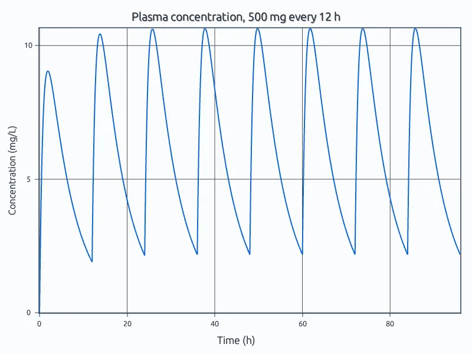

# Repeated oral dosing to steady state: a one-compartment pharmacokinetic model

[](https://runmat.com/sandbox?example=life-sciences-pk-dosing)

This example simulates the plasma concentration of a drug given orally at 500 mg every 12 hours,
with a one-compartment model with first-order absorption, integrated dose by dose with `ode45`. Over
eight doses the concentration settles to a steady state with a 10.6 mg/L peak and a 2.2 mg/L
trough. The trough accumulates 1.15 times over the first dose's, matching the closed form.

<picture>
  <source media="(prefers-color-scheme: dark)" srcset=".artifacts/thumbnail.webp">
  
</picture>

## The problem

A dosing regimen has to keep the drug concentration inside its therapeutic window: troughs high
enough to stay effective, peaks low enough to stay safe. With repeated doses, each new dose adds to
what is left of the previous ones, so the concentration rises until elimination over one interval
balances one dose. Pharmacologists estimate the steady-state peak and trough, and how long it takes
to get there, from a compartment model fitted to patient data.

The one-compartment oral model has a gut amount A_g and a plasma amount A_p:

$$\frac{dA_g}{dt} = -k_a A_g, \qquad \frac{dA_p}{dt} = k_a A_g - k_e A_p, \qquad C = \frac{A_p}{V}$$

Here the absorption rate k_a is 1.2 per hour, the elimination rate k_e is 0.17 per hour (a
4.1-hour half-life), and the volume of distribution V is 40 L. For doses every τ hours, the
accumulation of the trough at steady state over the first dose's trough is

$$R = \frac{1}{1 - e^{-k_e \tau}}$$

## How the example works

1. **Write the model** as a two-state ODE:

   ```matlab
   f = @(t, x) [-ka*x(1); ka*x(1) - ke*x(2)];
   ```

2. **Integrate one dosing interval at a time.** At the end of each interval, the next 500 mg goes
   into the gut state, and the integration restarts from there:

   ```matlab
   [ts, xs] = ode45(f, linspace((n-1)*tau, n*tau, 200), x0);
   x0 = xs(end, :)' + [dose; 0];
   ```

3. **Read the steady state** from the last interval, take the first dose's trough at 12 hours,
   and compare their ratio with the closed form `1 / (1 - exp(-ke*tau))`:

   ```matlab
   late = tt > (doses-1)*tau;
   first = cc(find(tt <= tau, 1, 'last'));
   ```

4. **Plot** the concentration over the 96 hours.

## Results

```
steady-state peak 10.6 mg/L, trough 2.2 mg/L
trough accumulation 1.15 against the first dose (closed form 1.15)
```

The first dose peaks at 9.1 mg/L about 1.9 hours after it is given and falls to 1.9 mg/L by the
second dose. With a 4.1-hour half-life against a 12-hour interval, little drug carries over, so the
accumulation is small and the profile reaches steady state within the first two or three doses.
The peak-to-trough swing at steady state is almost fivefold. A narrow therapeutic window would call
for smaller, more frequent doses.

## What to try

1. Give the same 500 mg every 8 hours with `tau = 8`. The closed-form steady state is a
   12.8 mg/L peak and a 5.0 mg/L trough, with an accumulation of 1.35.
2. Split the daily dose to 250 mg every 6 hours (`dose = 250; tau = 6; doses = 16`). The swing
   narrows to a 7.6 mg/L peak and a 4.1 mg/L trough.
3. Slow the absorption to `ka = 0.3`, as for an extended-release form, and look at how the peak
   flattens and moves later.

## Files

- `pk-dosing.m`: the script: one-compartment model, dose-by-dose integration, steady-state check and the plot.
- `runmat.toml`: the project file.

## Related

- [Life sciences in RunMat](https://runmat.com/industries/life-sciences)
- [Dose-response fit](../dose-response): potency of a compound from an assay
- Function reference: [`ode45`](https://runmat.com/docs/reference/builtins/ode45), [`exp`](https://runmat.com/docs/reference/builtins/exp), [`plot`](https://runmat.com/docs/reference/builtins/plot)
- [Download RunMat](https://runmat.com/download)
