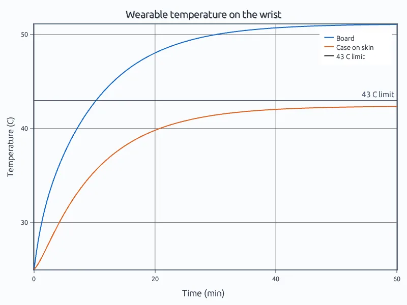

# Wearable device skin temperature: a two-node thermal model against the 43 °C contact limit

[](https://runmat.com/sandbox?example=life-sciences-wearable-temperature)

This example checks whether a wrist-worn device dissipating 0.35 W stays below the 43 °C limit for
skin contact. A two-node thermal network of the circuit board and the case, integrated with `ode45`
over an hour, puts the case at 42.4 °C, already at its steady-state value, with a margin of 0.6 K
to the limit.

<picture>
  <source media="(prefers-color-scheme: dark)" srcset=".artifacts/thumbnail.webp">
  
</picture>

## The problem

A device worn against the skin must not burn its wearer during long contact. Medical device safety
standards such as IEC 60601-1 cap the surface temperature of parts held on the skin for long
periods at 43 °C. The electronics' power has to leave through the case, partly into the skin and
partly into the air, so the case temperature depends on both paths.

A two-node lumped model captures this. The board, with heat capacity C_b, carries the power P and
conducts to the case through R_bc. The case, with heat capacity C_c, loses heat to the skin at
33 °C through R_skin and to the air at 25 °C through R_air:

$$C_b \dot T_b = P - \frac{T_b - T_c}{R_{bc}}, \qquad C_c \dot T_c = \frac{T_b - T_c}{R_{bc}} - \frac{T_c - T_{skin}}{R_{skin}} - \frac{T_c - T_{air}}{R_{air}}$$

At steady state the case sits at the skin and air temperatures weighted by their conductances,
plus the power times the parallel resistance of the two paths, 36 K/W here.

| Parameter | Value |
| --- | --- |
| Power P | 0.35 W |
| Board and case heat capacity | 4 J/K and 12 J/K |
| Board to case, case to skin, case to air | 25, 60 and 90 K/W |

## How the example works

1. **Write the two energy balances** as an ODE in the board and case temperatures:

   ```matlab
   f = @(t, T) [(P - (T(1) - T(2))/Rbc) / Cb;
                ((T(1) - T(2))/Rbc - (T(2) - Tskin)/Rskin - (T(2) - Tair)/Rair) / Cc];
   ```

2. **Integrate one hour** from both nodes at the 25 °C air temperature:

   ```matlab
   [t, T] = ode45(f, linspace(0, 3600, 600), [Tair; Tair]);
   ```

3. **Check against the closed-form steady state**:

   ```matlab
   Rpar = 1 / (1/Rskin + 1/Rair);
   steady = (Tskin/Rskin + Tair/Rair + P) * Rpar;
   ```

4. **Plot both temperatures** over the hour with the 43 °C limit as a horizontal line.

## Results

```
case 42.4 C after an hour, 42.4 C at steady state
margin to the 43 C skin-contact limit 0.6 K
```

The case passes 40 °C after about 20 minutes and levels off just under the limit. The model's slow
time constant is 10.1 minutes, so an hour is about six time constants and the case has reached its
steady state. The board runs 8.75 K hotter than the case, at 51.15 °C at steady state, set by the
0.35 W crossing the 25 K/W board-to-case path. A 0.6 K margin leaves little room: the power that
puts the case exactly at 43 °C is 0.367 W, only 5 % more.

## What to try

1. Raise the power to `P = 0.5`. The steady-state case temperature becomes 47.8 °C, 4.8 K over the
   limit.
2. Improve the path to air, for example with fins or a larger case, `Rair = 45`. The steady case
   temperature drops to 37.4 °C.
3. Run the device in bursts by making `P` a function of time inside `f`, and look at how much a
   duty cycle lowers the peak case temperature.

## Files

- `wearable-temperature.m`: the script: thermal network, one-hour simulation, steady-state check and the plot.
- `runmat.toml`: the project file.

## Related

- [Life sciences in RunMat](https://runmat.com/industries/life-sciences)
- [Heart-rate variability from an ECG](../hrv-ecg): signal analysis for the same kind of device
- Function reference: [`ode45`](https://runmat.com/docs/reference/builtins/ode45), [`yline`](https://runmat.com/docs/reference/builtins/yline), [`plot`](https://runmat.com/docs/reference/builtins/plot)
- [Download RunMat](https://runmat.com/download)
