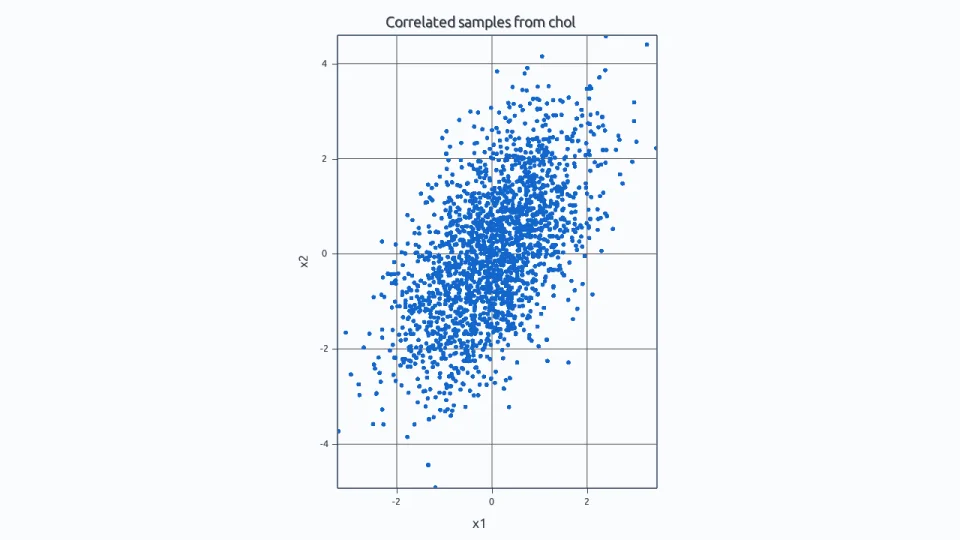

# Generate correlated random samples with a Cholesky factor

[](https://runmat.com/sandbox?example=linear-algebra-cholesky-samples)

This example draws 20000 random vectors with a chosen covariance matrix by multiplying independent
standard normal samples by the Cholesky factor of that matrix. The target covariance is
[1.00 0.80; 0.80 2.00], and the samples reproduce it as [1.00 0.81; 0.81 2.00]. The scatter plot
of the first 2000 points shows the tilted ellipse of a positive correlation.

<picture>
  <source media="(prefers-color-scheme: dark)" srcset=".artifacts/thumbnail.webp">
  
</picture>

## The problem

Monte Carlo studies often need inputs that vary together: two dimensions machined in the same
setup, wind loads at neighboring points, returns of related assets, temperature and humidity.
Sampling each input independently ignores that correlation and gets the spread of the output
wrong.

A covariance matrix Σ describes the variances and correlations. Any symmetric positive definite Σ
factors as Σ = RᵀR, with R upper triangular (the Cholesky factorization). If the rows of Z are
independent standard normal vectors, then X = ZR has

$$\text{Cov}(X) = R^\top \text{Cov}(Z)\, R = R^\top I\, R = \Sigma$$

so one matrix product turns independent samples into correlated ones. The factorization fails if
Σ is not positive definite, which also catches an inconsistent set of correlations.

## How the example works

1. **Factor the target covariance**:

   ```matlab
   Sigma = [1.0 0.8; 0.8 2.0];
   R = chol(Sigma);                  % Sigma = R' * R
   ```

   Here R = [1 0.8; 0 1.166].

2. **Draw independent samples** and correlate them:

   ```matlab
   Z = randn(20000, 2);
   X = Z * R;
   ```

3. **Check the sample covariance** with `cov(X)`.

4. **Plot** the first 2000 points with equal axis scaling.

## Results

```
Target covariance [1.00 0.80; 0.80 2.00]
Sample covariance [1.00 0.81; 0.81 2.00]
```

The sample covariance matches the target to within sampling error; the off-diagonal term differs
by 0.01 with 20000 samples. The correlation coefficient is 0.8/√2 = 0.57. In the figure, the cloud
is stretched along a line rising to the right, and it is taller than it is wide because x2 has twice
the variance of x1. The samples are not seeded, so the last digit of the sample covariance can
change between runs.

## What to try

1. Set the off-diagonal terms to −0.8 and see the ellipse tilt the other way.
2. Raise the off-diagonal to 1.5. Then 1.5² > 1.0 × 2.0, the matrix is not positive definite, and
   `chol` reports an error.
3. Extend to three variables with a 3 × 3 covariance and check `cov(X)` again.

## Files

- `cholesky-samples.m`: the script: Cholesky factor, correlated samples, covariance check and the scatter plot.
- `runmat.toml`: the project file.

## Related

- [Linear algebra in RunMat](https://runmat.com/math/linear-algebra)
- [Monte Carlo stack-up](../../statistics/monte-carlo) and [can I trust a solve?](../trust-a-solve)
- Function reference: [`chol`](https://runmat.com/docs/reference/builtins/chol), [`cov`](https://runmat.com/docs/reference/builtins/cov), [`randn`](https://runmat.com/docs/reference/builtins/randn)
- [Download RunMat](https://runmat.com/download)
