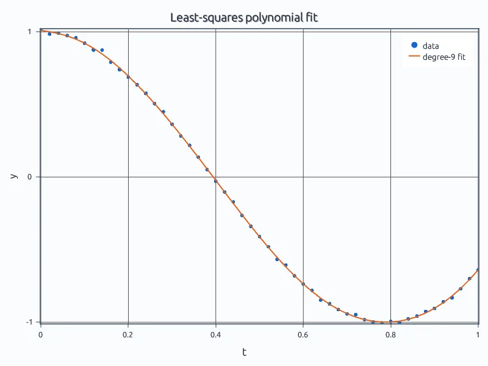

# Least squares three ways: normal equations, QR and the pseudoinverse

[](https://runmat.com/sandbox?example=linear-algebra-least-squares)

This example fits a degree-9 polynomial to 51 noisy samples of cos(4t) by solving the same
least-squares problem three ways. The design matrix has condition number 3.6 × 10⁶, and forming
the normal equations squares it to 1.3 × 10¹³. The normal-equations coefficients land 7.3 × 10⁻²
away from the QR solution, while the pseudoinverse agrees with QR to 3.0 × 10⁻¹¹.

<picture>
  <source media="(prefers-color-scheme: dark)" srcset=".artifacts/thumbnail.webp">
  
</picture>

## The problem

Fitting a model that is linear in its coefficients means solving an overdetermined system Ac ≈ y
in the least-squares sense. Calibrations, polynomial fits, system identification and sensor fusion
all reduce to it. There are three standard ways to solve it:

- **Normal equations**: solve (AᵀA)c = Aᵀy. It is quick and easy to write, but forming AᵀA squares
  the condition number, so it loses twice as many digits as the problem itself requires.
- **QR**: factor A = QR and solve Rc = Qᵀy. It works on A directly and never forms AᵀA. The
  backslash operator uses this for a rectangular A.
- **SVD**: the pseudoinverse uses the singular value decomposition. It costs the most and handles
  rank-deficient A.

A monomial basis t⁰…t⁹ on [0, 1] is badly conditioned, because high powers of t look alike.

## How the example works

1. **Build the data and the design matrix**, one column per power of t:

   ```matlab
   t = (0:0.02:1)';
   y = cos(4*t) + 0.01*randn(size(t));
   A = t .^ (0:9);
   ```

2. **Solve three ways**:

   ```matlab
   c1 = (A' * A) \ (A' * y);         % normal equations
   c2 = A \ y;                        % QR, through backslash
   c3 = pinv(A) * y;                  % SVD
   ```

3. **Compare** the condition numbers of A and AᵀA, and each solution's distance from the QR
   solution.

4. **Plot** the data and the QR fit.

## Results

```
cond(A) = 3.6e+06, cond(A'*A) = 1.3e+13
Off from QR: normal equations 7.3e-02, pinv 3.0e-11
```

cond(AᵀA) is cond(A)², as the theory says. With about 16 significant digits in double precision,
a condition number of 10¹³ leaves about 3 reliable digits in the normal-equations coefficients,
and they differ from the QR coefficients by 0.073. QR and the pseudoinverse agree to 3.0 × 10⁻¹¹.
The fitted curve in the figure follows the data closely; the coefficient error is in directions
that barely change the curve on [0, 1], which is exactly why the problem is ill-conditioned.

## What to try

1. Center and scale t first, `s = 2*t - 1`, build `A = s .^ (0:9)` and compare the condition
   numbers.
2. Raise the degree to 14 and look at how far the normal equations drift.
3. Compare `A*c1` with `A*c2` to see how little the fitted values differ despite the coefficients.

## Files

- `least-squares.m`: the script: design matrix, three solves, condition numbers and the plot.
- `runmat.toml`: the project file.

## Related

- [Linear algebra in RunMat](https://runmat.com/math/linear-algebra)
- [Can I trust a solve?](../trust-a-solve) and [choosing a polynomial degree](../../curve-fitting/choose-degree)
- Function reference: [`mldivide`](https://runmat.com/docs/reference/builtins/mldivide), [`pinv`](https://runmat.com/docs/reference/builtins/pinv), [`cond`](https://runmat.com/docs/reference/builtins/cond)
- [Download RunMat](https://runmat.com/download)
