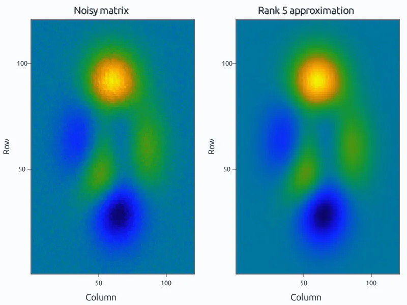

# Low-rank approximation with the SVD: denoise a matrix

[](https://runmat.com/sandbox?example=linear-algebra-low-rank-svd)

This example adds noise to a smooth 120 × 120 surface and keeps only the first five terms of its
singular value decomposition. Rank 5 carries 99.0 % of the matrix's energy. The noisy matrix is
off from the clean surface by 0.104 in relative Frobenius norm; the rank-5 approximation cuts that
to 0.034.

<picture>
  <source media="(prefers-color-scheme: dark)" srcset=".artifacts/thumbnail.webp">
  
</picture>

## The problem

Many engineering data sets are matrices whose real content is low-rank: a field sampled on a grid,
a set of sensor channels driven by a few modes, a sequence of snapshots from a simulation. Noise
spreads evenly across all singular values, while the signal concentrates in the first few.

The SVD writes A = UΣVᵀ, with singular values σ₁ ≥ σ₂ ≥ … ≥ 0. Truncating to the first r terms,

$$A_r = \sum_{i=1}^{r} \sigma_i\, u_i v_i^\top$$

gives the best rank-r approximation in the Frobenius and 2-norms (the Eckart-Young theorem). The
fraction of energy kept is Σᵢ≤ᵣ σᵢ² / Σ σᵢ². The same truncation underlies principal component
analysis, proper orthogonal decomposition of simulation results and image compression.

## How the example works

1. **Make the matrix**: the `peaks` surface on a 120 × 120 grid, plus noise with standard
   deviation 0.2:

   ```matlab
   Z = peaks(120);
   A = Z + 0.2*randn(size(Z));
   ```

2. **Decompose and truncate** to rank 5:

   ```matlab
   [U, S, V] = svd(A);
   Ar = U(:, 1:r) * S(1:r, 1:r) * V(:, 1:r)';
   ```

3. **Measure** the energy kept and each matrix's relative error against the clean surface:

   ```matlab
   energy = cumsum(s.^2) / sum(s.^2);
   norm(Ar - Z, 'fro')/norm(Z, 'fro')
   ```

4. **Show** the noisy matrix and the rank-5 approximation side by side with `imagesc`.

## Results

```
Rank 5 keeps 99.0% of the energy
Relative error: noisy 0.104, rank 5 0.034
```

Five of 120 singular values carry 99.0 % of the energy, and keeping only them removes about two
thirds of the error: the relative error falls from 0.104 to 0.034. The rank-5 matrix is stored as
5 × (120 + 120 + 1) = 1205 numbers instead of 14400. In the figure the two images show the same
peaks and valleys, with the grain of the noise gone from the right one.

## What to try

1. Plot `semilogy(s)` to see the first few singular values stand above a flat noise floor.
2. Try `r = 3` and `r = 10` and compare the relative errors with rank 5.
3. Raise the noise to `0.5*randn(size(Z))` and see which rank gives the smallest error.

## Files

- `low-rank-svd.m`: the script: noisy matrix, SVD truncation, energy and error, and the two images.
- `runmat.toml`: the project file.

## Related

- [Linear algebra in RunMat](https://runmat.com/math/linear-algebra)
- [Principal components](../../statistics/principal-components) and [least squares three ways](../least-squares)
- Function reference: [`svd`](https://runmat.com/docs/reference/builtins/svd), [`peaks`](https://runmat.com/docs/reference/builtins/peaks), [`imagesc`](https://runmat.com/docs/reference/builtins/imagesc)
- [Download RunMat](https://runmat.com/download)
