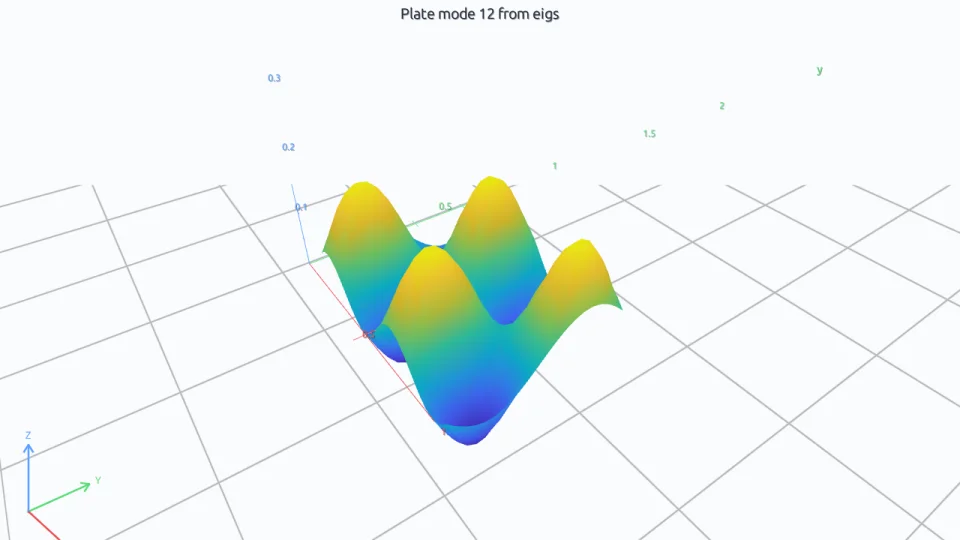

# Vibration modes of a rectangular membrane from a sparse Laplacian with eigs

[](https://runmat.com/sandbox?example=linear-algebra-plate-mode)

This example builds the five-point finite-difference Laplacian on a 30 × 20 interior grid, stores
it as a sparse matrix, and asks `eigs` for its 12 smallest eigenvalues. It draws the 12th mode as a
surface. For this grid the 12th eigenvalue is 278.5, the mode with three half-waves in each
direction.

<picture>
  <source media="(prefers-color-scheme: dark)" srcset=".artifacts/thumbnail.webp">
  
</picture>

## The problem

The natural frequencies and mode shapes of a structure come from an eigenvalue problem. For a
stretched membrane fixed at its edges, such as a drumhead or a thin sheet under tension, the
problem is the Laplacian eigenproblem

$$-\nabla^2 w = \lambda\, w, \qquad w = 0 \text{ on the boundary}$$

and each frequency is proportional to √λ. Discretized on a grid, it becomes a matrix eigenproblem
Kv = λv. The matrix has one row per grid point but only five nonzeros per row, so it is stored
sparse. Only the lowest few modes matter in practice, and `eigs` finds a handful of eigenpairs
without computing them all.

For the five-point Laplacian on an nx × ny grid with spacing h, the eigenvalues are known exactly:

$$\lambda_{ij} = \frac{1}{h^2}\left[4 - 2\cos\frac{i\pi}{n_x + 1} - 2\cos\frac{j\pi}{n_y + 1}\right]$$

which gives a check on the numerical result.

## How the example works

1. **Lay out the grid**: 30 × 20 interior points with spacing h = 1/31, so the membrane is 1 long and
   21/31 wide.

2. **Build the Laplacian** as a Kronecker sum of 1-D second-difference matrices, and store it
   sparse:

   ```matlab
   T = @(m) toeplitz([2 -1 zeros(1, m - 2)]);
   K = sparse(kron(eye(nx), T(ny)) + kron(T(nx), eye(ny)));
   ```

3. **Find the 12 smallest eigenvalues** and sort them:

   ```matlab
   [V, D] = eigs(K, 12, 'smallestabs');
   [lambda, order] = sort(diag(D) / h^2);
   ```

4. **Draw mode 12** as a surface, normalized so its largest displacement is 15 % of the length.

## Results

From the exact formula, the 12 lowest eigenvalues run from 31.3 for the fundamental, one
half-wave each way, to 278.5 for mode 12, three half-waves each way. Mode 12 therefore has a
3 × 3 pattern of alternating crests and troughs separated by straight nodal lines. In the figure
the surface is drawn with interpolated shading at a −35° azimuth.

## What to try

1. Draw the fundamental with `v = V(:, order(1))` and compare it with mode 12.
2. Compare `lambda` with the exact formula above for each mode.
3. Refine the grid to `nx = 61; ny = 41;`, which keeps the same shape at half the spacing, and
   compare the lowest eigenvalue with the continuous value π²(1 + (31/21)²) = 31.4.

## Files

- `plate-mode.m`: the script: grid, sparse Laplacian, eigs and the surface plot.
- `runmat.toml`: the project file.

## Related

- [Linear algebra in RunMat](https://runmat.com/math/linear-algebra)
- [Sparse eigenvalues](../sparse-eigs) and [spring-mass modes](../spring-mass-modes)
- Function reference: [`eigs`](https://runmat.com/docs/reference/builtins/eigs), [`sparse`](https://runmat.com/docs/reference/builtins/sparse), [`kron`](https://runmat.com/docs/reference/builtins/kron), [`surf`](https://runmat.com/docs/reference/builtins/surf)
- [Download RunMat](https://runmat.com/download)
