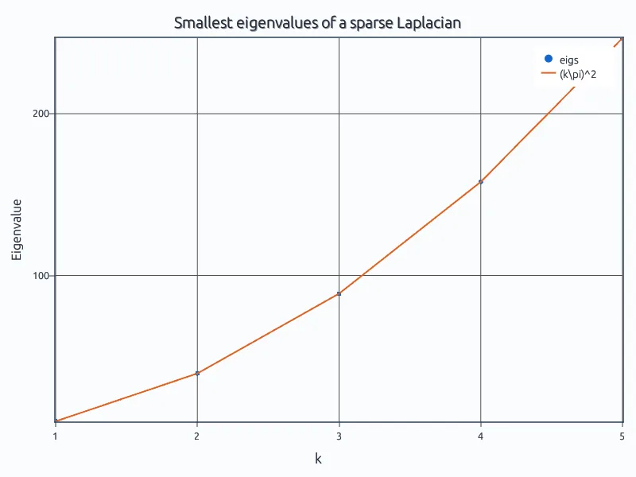

# Smallest eigenvalues of a sparse matrix with eigs: the 1-D Laplacian

[](https://runmat.com/sandbox?example=linear-algebra-sparse-eigs)

This example builds the second-difference matrix for 500 interior points as a sparse matrix with
1498 nonzeros, asks `eigs` for its five smallest eigenvalues, and compares them with (kπ)², the
eigenvalues of −d²/dx² on [0, 1] with fixed ends. For this grid the discrete eigenvalues sit within
8.2 × 10⁻⁵ of the continuous ones, a gap set by the grid spacing.

<picture>
  <source media="(prefers-color-scheme: dark)" srcset=".artifacts/thumbnail.webp">
  
</picture>

## The problem

Discretizing a differential operator gives a large matrix that is almost entirely zeros. The
operator −d²/dx² on 500 points becomes a 500 × 500 matrix with only three nonzeros per row. The
quantities of interest, such as the lowest natural frequencies of a string, a beam or an acoustic
duct, are its few smallest eigenvalues.

Storing such a matrix densely wastes memory and time, and computing all 500 eigenvalues with `eig`
does far more work than needed. `eigs` works on the sparse matrix and returns only the eigenpairs
requested. With `'smallestabs'` it targets the eigenvalues nearest zero.

For the second-difference matrix the answer is known. With spacing h = 1/(n + 1), its eigenvalues
divided by h² are

$$\lambda_k = \frac{2 - 2\cos(k\pi h)}{h^2} = (k\pi)^2\left(1 - \frac{(k\pi h)^2}{12} + \dots\right)$$

so they approach (kπ)² as the grid is refined, with a relative gap of about (kπh)²/12.

## How the example works

1. **Build the sparse matrix** from its three diagonals:

   ```matlab
   n = 500;  h = 1/(n + 1);
   e = ones(n, 1);
   L = spdiags(e * [-1 2 -1], -1:1, n, n);
   ```

2. **Ask for the five smallest eigenvalues** and scale them by 1/h²:

   ```matlab
   lambda = sort(eigs(L, 5, 'smallestabs')) / h^2;
   ```

3. **Compare** with the continuous values (kπ)² and report the largest relative difference.

4. **Plot** both against k.

## Results

The matrix is 500 by 500 with 1498 nonzeros: 500 on the diagonal and 499 on each neighbor
diagonal, 0.6 % of the entries. From the formula above, the five smallest scaled eigenvalues are
9.8696, 39.478, 88.824, 157.91 and 246.72, against (kπ)² = 9.8696, 39.478, 88.826, 157.91 and
246.74. The relative gap grows as k², from 3.3 × 10⁻⁶ for k = 1 to 8.2 × 10⁻⁵ for k = 5. The figure
plots the `eigs` results and (kπ)² against k.

## What to try

1. Halve the spacing with `n = 1001` and check that the largest relative gap falls by about four.
2. Ask for the 20 smallest eigenvalues and see where the gap from (kπ)² grows past 10⁻³.
3. Use `[V, D] = eigs(L, 5, 'smallestabs')` and plot the columns of `V` to see the sine-shaped
   modes.

## Files

- `sparse-eigs.m`: the script: sparse second-difference matrix, eigs, comparison and the plot.
- `runmat.toml`: the project file.

## Related

- [Linear algebra in RunMat](https://runmat.com/math/linear-algebra)
- [Membrane vibration modes](../plate-mode) and [spring-mass modes](../spring-mass-modes)
- Function reference: [`eigs`](https://runmat.com/docs/reference/builtins/eigs), [`spdiags`](https://runmat.com/docs/reference/builtins/spdiags), [`nnz`](https://runmat.com/docs/reference/builtins/nnz)
- [Download RunMat](https://runmat.com/download)
