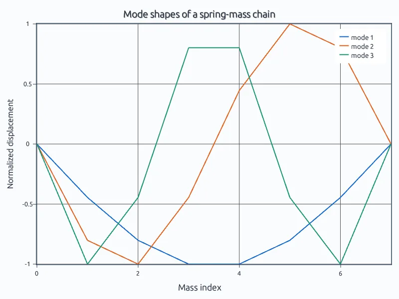

# Natural frequencies and mode shapes of a spring-mass chain with eig

[](https://runmat.com/sandbox?example=linear-algebra-spring-mass-modes)

This example finds the natural frequencies and mode shapes of six 2 kg masses joined by 1000 N/m
springs and fixed at both ends. It solves the eigenvalue problem with `eig` and checks every
frequency against the closed form. The lowest three modes are at 1.58, 3.09 and 4.44 Hz, and all
six agree with the closed form to 2.7 × 10⁻¹⁵ Hz.

<picture>
  <source media="(prefers-color-scheme: dark)" srcset=".artifacts/thumbnail.webp">
  
</picture>

## The problem

A lumped spring-mass model is the first step in most vibration analysis: a drivetrain, a building's
floors, a tube bundle, a chain of components on a rail. Free vibration of n masses obeys
Mẍ + Kx = 0. Trying x = v sin ωt gives the eigenvalue problem

$$M^{-1}K\,v = \omega^2 v$$

Each eigenvalue is a squared natural frequency ω², and its eigenvector is the mode shape: the
relative motion of the masses at that frequency.

For n equal masses m and equal springs k with both ends fixed, K is k times the tridiagonal matrix
with 2 on the diagonal and −1 beside it, and the frequencies have a closed form:

$$f_i = \frac{1}{\pi}\sqrt{\frac{k}{m}}\,\sin\frac{i\pi}{2(n + 1)}, \qquad i = 1, \dots, n$$

## How the example works

1. **Build the stiffness matrix** for six masses fixed at both ends:

   ```matlab
   n = 6;  k = 1000;  m = 2;
   K = k * toeplitz([2 -1 zeros(1, n - 2)]);
   ```

2. **Solve the eigenvalue problem** and sort the modes by frequency:

   ```matlab
   [V, D] = eig(K / m);
   [w2, order] = sort(diag(D));
   f = sqrt(w2) / (2*pi);
   ```

3. **Compare** with the closed form.

4. **Plot** the first three mode shapes, with the fixed ends added as zeros and each shape scaled to
   a peak of 1.

## Results

```
Lowest three modes: 1.58, 3.09, 4.44 Hz
Largest difference from the closed form: 2.7e-15 Hz
```

The six frequencies run 1.58, 3.09, 4.44, 5.56, 6.41 and 6.94 Hz. They crowd together toward the
top because the sine in the closed form flattens near π/2. The difference from the closed form is
at the level of rounding in double precision. In the figure, mode 1 moves every mass the same way
with the largest motion in the middle, mode 2 has one node at the center, and mode 3 has two
nodes, each shape a sampled half, full and one-and-a-half sine wave.

## What to try

1. Free one end by changing the last diagonal entry of `K` to `k`, and compare the frequencies.
2. Make the fourth mass 10 kg with `M = diag([2 2 2 10 2 2])` and solve `eig(M \ K)`.
3. Raise `n` to 50 and plot `f` against the closed form to see the full dispersion curve.

## Files

- `spring-mass-modes.m`: the script: stiffness matrix, eig, closed-form check and the mode-shape plot.
- `runmat.toml`: the project file.

## Related

- [Linear algebra in RunMat](https://runmat.com/math/linear-algebra)
- [Sparse eigenvalues](../sparse-eigs) and [damped oscillator](../../differential-equations/damped-oscillator)
- Function reference: [`eig`](https://runmat.com/docs/reference/builtins/eig), [`toeplitz`](https://runmat.com/docs/reference/builtins/toeplitz)
- [Download RunMat](https://runmat.com/download)
