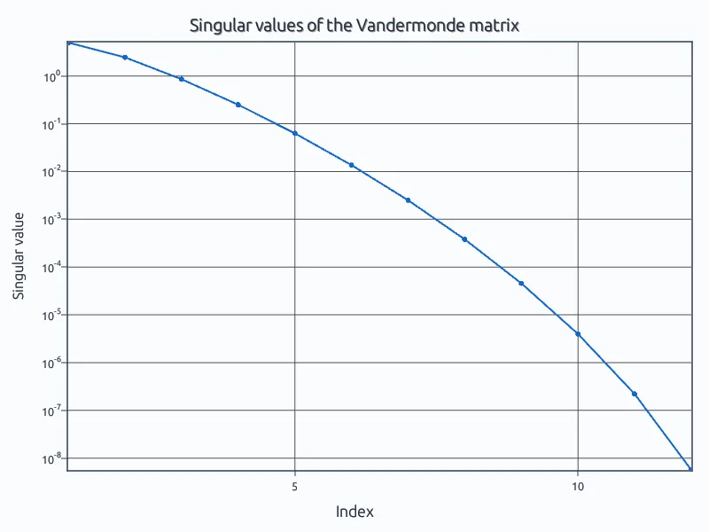

# Solving an ill-conditioned linear system: inv(A)*b against A\b

[](https://runmat.com/sandbox?example=linear-algebra-trust-a-solve)

This example solves a 12 × 12 Vandermonde system whose exact answer is known, once with the
explicit inverse and once with backslash, and measures each answer's error. The matrix has
condition number 8.8 × 10⁸, so about 9 of 16 digits are at risk. `inv(A)*b` misses the answer by
9.8 × 10⁻⁷; `A\b` misses it by 1.1 × 10⁻⁷, about nine times less.

<picture>
  <source media="(prefers-color-scheme: dark)" srcset=".artifacts/thumbnail.webp">
  
</picture>

## The problem

Solving Ax = b is the inner step of most engineering computation: finite element and circuit
solves, calibrations, interpolation, implicit time stepping. Two questions decide whether an answer
can be trusted. How sensitive is the problem itself? And does the method add error of its own?

The condition number answers the first. In double precision, with about 16 significant digits, a
solve can lose about log₁₀ cond(A) of them however carefully it is done. The singular values show
where the sensitivity comes from: cond(A) is the ratio of the largest to the smallest.

The method answers the second. Backslash factors A (LU with pivoting for a square matrix) and
solves with the factors. Forming inv(A) first and multiplying adds a further rounding step and is
usually less accurate as well as slower.

## How the example works

1. **Build a system with a known answer**: the Vandermonde matrix of 12 evenly spaced points on
   [0, 1], and the right-hand side that makes every unknown equal to 1:

   ```matlab
   x = (0:11)' / 11;
   A = x .^ (0:11);
   xtrue = ones(12, 1);
   b = A * xtrue;
   ```

2. **Solve both ways**:

   ```matlab
   x1 = inv(A) * b;
   x2 = A \ b;
   ```

3. **Report** the condition number and each solution's error against `xtrue`.

4. **Plot** the singular values on a log scale.

## Results

```
cond(A) = 8.8e+08, so expect to lose about 9 of 16 digits
Error: inv(A)*b 9.8e-07, A\b 1.1e-07
```

Both errors fit the condition number's prediction: with 9 digits at risk, errors of 10⁻⁷ to 10⁻⁶
are about what 16-digit arithmetic leaves. Backslash comes out about nine times more accurate than
the explicit inverse on the same matrix. In the figure the singular values fall steadily across
nine orders of magnitude, with no single small one standing out: every added power of x is a
little closer to the ones before it.

## What to try

1. Reduce the size to 8 with `x = (0:7)' / 7` and `A = x .^ (0:7)`, and compare the condition
   number and both errors.
2. Use Chebyshev points, `x = (1 - cos(pi*(0:11)'/11))/2`, and see how much the condition number
   drops.
3. Check the residual `norm(A*x2 - b)`. It stays small even when the error in x is large, so the
   residual alone does not show an ill-conditioned solve.

## Files

- `trust-a-solve.m`: the script: Vandermonde system, both solves, errors and the singular value plot.
- `runmat.toml`: the project file.

## Related

- [Linear algebra in RunMat](https://runmat.com/math/linear-algebra)
- [Least squares three ways](../least-squares) and [low-rank approximation](../low-rank-svd)
- Function reference: [`mldivide`](https://runmat.com/docs/reference/builtins/mldivide), [`cond`](https://runmat.com/docs/reference/builtins/cond), [`svd`](https://runmat.com/docs/reference/builtins/svd), [`inv`](https://runmat.com/docs/reference/builtins/inv)
- [Download RunMat](https://runmat.com/download)
