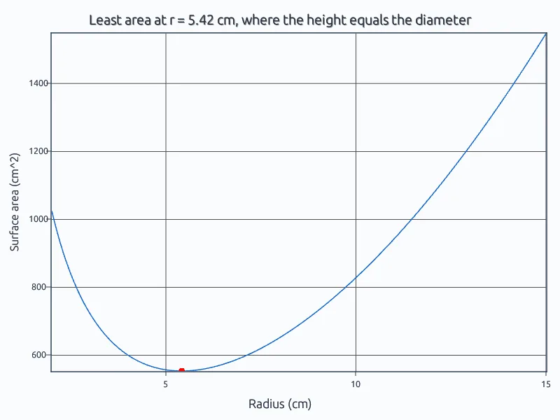

# Minimum-material can for one liter: a one-variable optimization with fminbnd

[](https://runmat.com/sandbox?example=optimization-cheapest-can)

This example finds the cylindrical can that holds 1000 cm³ with the least sheet metal. `fminbnd`
searches radii from 1 to 20 cm and finds the minimum in 10 function evaluations: a radius of
5.42 cm, a height of 10.84 cm and a surface area of 553.6 cm². At the optimum the height equals the
diameter.

<picture>
  <source media="(prefers-color-scheme: dark)" srcset=".artifacts/thumbnail.webp">
  
</picture>

## The problem

Sizing a part often comes down to one free dimension once the requirements fix the rest. Here the
volume is fixed at V = 1000 cm³, so the height follows from the radius, h = V/(πr²), and the
material is the surface area

$$A(r) = 2\pi r^2 + \frac{2V}{r}$$

The first term, top and bottom, grows with r; the second, the side wall, shrinks. Setting
dA/dr = 0 gives r = (V/2π)^(1/3) and h = 2r. Real cans are taller than this, because the ends are
thicker than the wall and seams cost material. The method is the same once those costs enter A(r).

`fminbnd` minimizes a function of one variable on an interval, with golden-section search and
parabolic interpolation, and needs no derivative.

## How the example works

1. **Write the area** as a function of the radius alone:

   ```matlab
   V = 1000;
   area = @(r) 2*pi*r.^2 + 2*V./r;
   ```

2. **Minimize between 1 and 20 cm**, keeping the evaluation count:

   ```matlab
   [r, a, flag, out] = fminbnd(area, 1, 20);
   h = V/(pi*r^2);
   ```

3. **Report** the radius, height, area and the height-to-diameter ratio.

4. **Plot** the area from 2 to 15 cm with the minimum marked.

## Results

```
Radius 5.42 cm, height 10.84 cm, area 553.6 cm^2 (10 evaluations)
Height over diameter: 1.000
```

The result matches the calculus answer, r = (1000/2π)^(1/3) = 5.419 cm, with area 6πr² = 553.6 cm².
The curve in the figure is flat near the minimum: radii a few millimeters either side cost almost
nothing extra, while a narrow can, with r near 2 cm, needs nearly twice the metal.

## What to try

1. Make the ends twice as thick as the wall: `area = @(r) 4*pi*r.^2 + 2*V./r`. The optimum moves
   to r = (V/4π)^(1/3) = 4.30 cm, with h = 4r.
2. Change the volume to 330 cm³ and compare the shape.
3. Add a seam allowance along the wall height and see how the optimum shifts.

## Files

- `cheapest-can.m`: the script: area function, fminbnd, the shape check and the plot.
- `runmat.toml`: the project file.

## Related

- [Optimization in RunMat](https://runmat.com/math/optimization)
- [Lightest beam](../lightest-beam) and [local minima](../local-minima)
- Function reference: [`fminbnd`](https://runmat.com/docs/reference/builtins/fminbnd)
- [Download RunMat](https://runmat.com/download)
