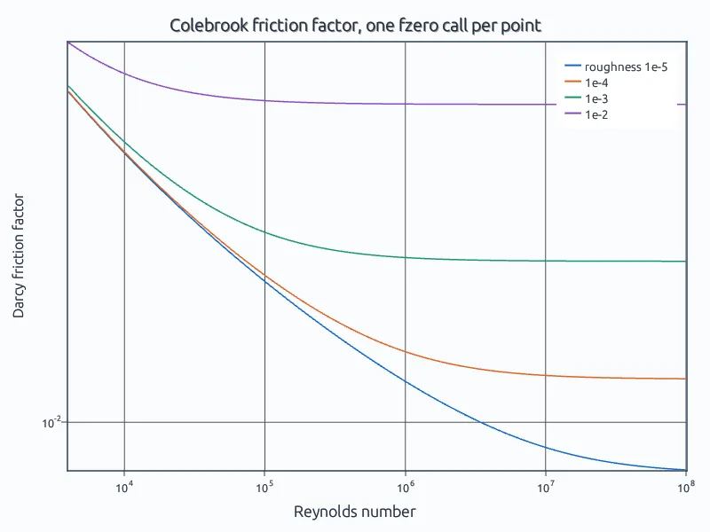

# Colebrook friction factor with fzero: a Moody chart in a few lines

[](https://runmat.com/sandbox?example=optimization-colebrook-friction)

This example solves the Colebrook equation for the Darcy friction factor of turbulent pipe flow,
which has no explicit solution, with `fzero`. At a Reynolds number of 10⁵ and relative roughness
10⁻⁴, it converges to f = 0.01851 in 11 evaluations; the explicit Haaland approximation gives
0.01827. Repeating the solve across Reynolds numbers and four roughness values draws a small Moody
chart.

<picture>
  <source media="(prefers-color-scheme: dark)" srcset=".artifacts/thumbnail.webp">
  
</picture>

## The problem

Pressure drop in a pipe follows the Darcy-Weisbach equation, Δp = f (L/D) ρv²/2, and the friction
factor f depends on the Reynolds number Re and the relative roughness ε/D. For turbulent flow the
standard relation is the Colebrook equation:

$$\frac{1}{\sqrt f} = -2\log_{10}\!\left(\frac{\varepsilon/D}{3.7} + \frac{2.51}{Re\sqrt f}\right)$$

f appears on both sides, so it must be solved iteratively. Explicit fits such as Haaland's are
convenient and agree within a few percent. A root finder solves the equation itself, to machine
precision, in a handful of evaluations, which is cheap enough to do at every operating point in a
pipe network.

## How the example works

1. **Write Colebrook as a residual** that is zero at the solution:

   ```matlab
   colebrook = @(f, Re, rr) 1/sqrt(f) + 2*log10(rr/3.7 + 2.51/(Re*sqrt(f)));
   ```

2. **Solve one point** inside a bracket that contains the root:

   ```matlab
   [fd, ~, ~, out] = fzero(@(f) colebrook(f, 1e5, 1e-4), [0.005 0.1]);
   ```

3. **Compare** with Haaland's explicit formula,
   f = [−1.8 log₁₀((ε/D/3.7)^1.11 + 6.9/Re)]⁻².

4. **Sweep** 60 Reynolds numbers from about 4000 to 10⁸ and four roughness values, one `fzero` call
   per point, and plot on log-log axes.

## Results

```
Re = 1e5, relative roughness 1e-4: f = 0.01851 after 11 evaluations
Haaland explicit approximation: f = 0.01827
```

Haaland is 1.3 % below the Colebrook solution at this point. In the chart, every curve falls with
Reynolds number and then levels off. The rougher the wall, the earlier it levels: at ε/D = 10⁻² the
curve is nearly flat across the whole range, while at 10⁻⁵ it is still falling at Re = 10⁸. The
flat values are the fully rough limit, 1/√f = 2 log₁₀(3.7/(ε/D)), which gives 0.0120 for
ε/D = 10⁻⁴ and 0.0379 for 10⁻².

## What to try

1. Add the smooth-pipe curve with `roughness = 0`.
2. Plot Haaland's formula over the Colebrook curves and look for where they differ most.
3. Use the friction factor to compute the pressure drop in 100 m of 50 mm pipe carrying water at
   2 m/s.

## Files

- `colebrook-friction.m`: the script: Colebrook residual, single solve, Haaland check, sweep and the chart.
- `runmat.toml`: the project file.

## Related

- [Optimization in RunMat](https://runmat.com/math/optimization)
- [Two equations, two unknowns](../two-equations) and [stopping tests](../stopping-tests)
- Function reference: [`fzero`](https://runmat.com/docs/reference/builtins/fzero), [`loglog`](https://runmat.com/docs/reference/builtins/loglog)
- [Download RunMat](https://runmat.com/download)
