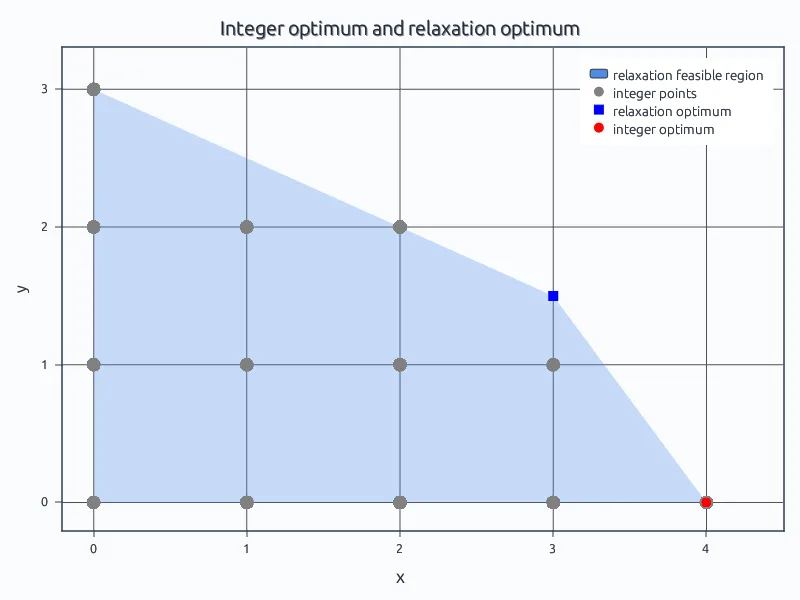

# Integer linear programming: whole units against the linear relaxation

[](https://runmat.com/sandbox?example=optimization-integer-program)

This example maximizes 5x + 4y under two resource limits, once allowing fractional amounts with
`linprog` and once requiring whole units with `intlinprog`. The relaxation's optimum is the corner
(3, 1.5), worth 21. The best integer point is (4, 0), worth 20, and it is not the integer point
nearest the relaxation's corner.

<picture>
  <source media="(prefers-color-scheme: dark)" srcset=".artifacts/thumbnail.webp">
  
</picture>

## The problem

Production planning, cutting stock, crew and machine scheduling, and part selection decide counts:
whole batches, whole machines, whole trucks. A linear program that ignores this gives fractional
answers. Rounding them can break a constraint or miss the best plan.

Here x and y are two products earning 5 and 4 per unit, with two limits:

$$\max\ 5x + 4y \quad \text{s.t.}\quad 6x + 4y \le 24,\ \ x + 2y \le 6,\ \ x, y \ge 0$$

The linear relaxation drops the integer requirement. Its optimum is an upper bound on the integer
optimum, and branch-and-bound solvers such as `intlinprog` use such bounds to prune the search.

## How the example works

1. **Set up the problem** in minimization form, as the solvers expect:

   ```matlab
   f = -[5 4];
   A = [6 4; 1 2]; b = [24; 6];
   lb = [0 0];
   ```

2. **Solve the relaxation**:

   ```matlab
   xr = linprog(f, A, b, [], [], lb);
   ```

3. **Solve the integer program**, marking variables 1 and 2 as integers:

   ```matlab
   [xi, fi] = intlinprog(f, [1 2], A, b, [], [], lb);
   ```

4. **Plot** the feasible region, the integer points inside it and both optima.

## Results

The relaxation's optimum is at (3, 1.5), where both limits are active, with value
5·3 + 4·1.5 = 21. Rounding it gives (3, 1), worth 19, or (3, 2), which breaks the second limit. The
integer optimum is (4, 0), worth 20, on the first limit's axis intercept. The gap between 21 and 20
is the cost of whole units. In the figure the feasible region is a quadrilateral with corners at
(0, 0), (4, 0), (3, 1.5) and (0, 3), and the two optima sit at different corners.

## What to try

1. Change the second product's profit to 6. The relaxation stays at (3, 1.5), now worth 24, and
   the integer optimum moves to (2, 2), worth 22.
2. Raise the first limit to 26. The relaxation moves to (3.5, 1.25), and the integer optimum stays
   at (4, 0).
3. Add a third product as a third variable and a column in `A`.

## Files

- `integer-program.m`: the script: problem data, linprog, intlinprog and the plot.
- `runmat.toml`: the project file.

## Related

- [Optimization in RunMat](https://runmat.com/math/optimization)
- [Production plan](../production-plan) and [shadow prices](../shadow-prices)
- Function reference: [`intlinprog`](https://runmat.com/docs/reference/builtins/intlinprog), [`linprog`](https://runmat.com/docs/reference/builtins/linprog)
- [Download RunMat](https://runmat.com/download)
