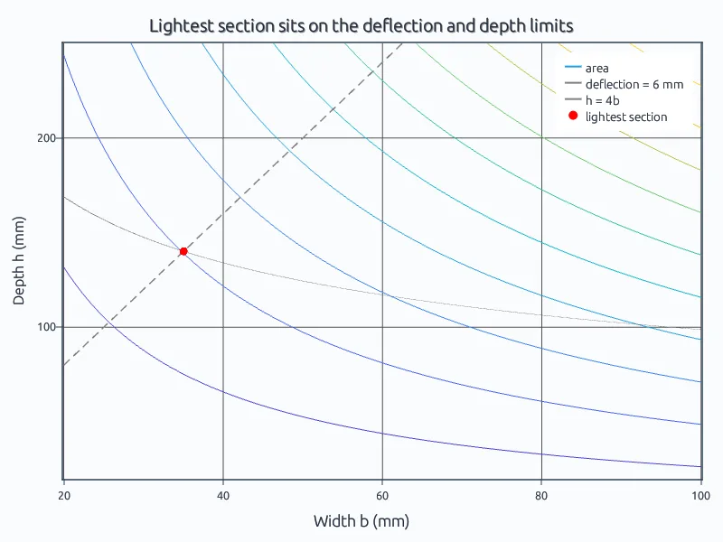

# Lightest cantilever beam section with fmincon: stress, deflection and depth limits

[](https://runmat.com/sandbox?example=optimization-lightest-beam)

This example sizes the lightest solid rectangular aluminum cantilever, 1.5 m long, that carries a
3000 N tip load. It minimizes the cross-section area with `fmincon` under three limits: bending
stress at most 160 MPa, tip deflection at most 6 mm, and depth at most four times the width. The
deflection and depth limits meet at the optimum, a section about 35 mm wide and 140 mm deep.

<picture>
  <source media="(prefers-color-scheme: dark)" srcset=".artifacts/thumbnail.webp">
  
</picture>

## The problem

Sizing a structural member means choosing dimensions that satisfy every requirement at the lowest
weight or cost. For a cantilever with tip load P, length L, width b and depth h, the requirements
are

$$\sigma = \frac{6PL}{bh^2} \le 160\ \text{MPa}, \qquad \delta = \frac{4PL^3}{Ebh^3} \le 6\ \text{mm}, \qquad h \le 4b$$

with E = 70 GPa for aluminum. The objective is the area bh, which sets the mass. Deep sections are
stiff and strong for their area, so the optimizer pushes h up until the depth limit stops it, a
stand-in for lateral buckling and manufacturing limits.

`fmincon` handles a nonlinear objective with bounds and nonlinear inequality constraints. The
constraints are written as c(v) ≤ 0 in a function that returns all three.

## How the example works

1. **Define the objective** over v = [b, h] in meters:

   ```matlab
   area = @(v) v(1)*v(2);
   ```

2. **Write the limits** as c ≤ 0:

   ```matlab
   c = [6*P*L/(v(1)*v(2)^2) - sigmaMax;      % bending stress
        4*P*L^3/(E*v(1)*v(2)^3) - deltaMax;  % tip deflection
        v(2) - 4*v(1)];                      % depth at most 4 widths
   ```

3. **Solve** from b = 50 mm, h = 100 mm, with widths from 20 to 100 mm and depths from 20 to
   250 mm:

   ```matlab
   [v, A] = fmincon(area, [0.05 0.10], [], [], [], [], lb, ub, limits, opts);
   ```

4. **Plot** contours of area over the design space with the deflection limit, the depth limit and
   the solution.

## Results

With h = 4b, the deflection limit becomes b⁴ = PL³/(16Eδ). From the script's values this gives
b = 35.0 mm and h = 140.1 mm, an area of 4910 mm², the lightest section that meets all three
limits. Its bending stress is 39 MPa, a quarter of the 160 MPa allowed, so stiffness governs the
design, not strength. In the figure, area contours fall toward the lower left, the deflection limit
is a curve falling from upper left to lower right, and the depth limit is the dashed line h = 4b.
Feasible sections lie above the curve and below the line, and the optimum is where they cross.

## What to try

1. Relax the deflection limit to 12 mm. The optimum moves down the h = 4b line, and the area falls
   by a factor of 2^(1/2), to about 3470 mm².
2. Switch to steel with `E = 200e9` and compare the section.
3. Remove the depth limit and see how deep and thin the optimizer makes the section.

## Files

- `lightest-beam.m`: the script: objective, limits, fmincon solve and the design-space plot.
- `runmat.toml`: the project file.

## Related

- [Optimization in RunMat](https://runmat.com/math/optimization)
- [Minimum-material can](../cheapest-can) and [shadow prices](../shadow-prices)
- Function reference: [`fmincon`](https://runmat.com/docs/reference/builtins/fmincon), [`optimoptions`](https://runmat.com/docs/reference/builtins/optimoptions), [`contour`](https://runmat.com/docs/reference/builtins/contour)
- [Download RunMat](https://runmat.com/download)
