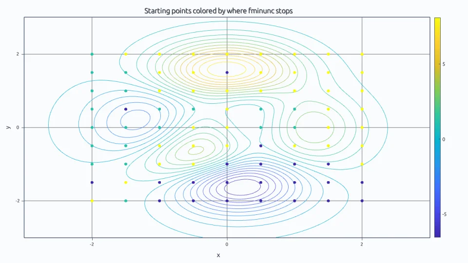

# Local and global minima: fminunc from a grid of starting points

[](https://runmat.com/sandbox?example=optimization-local-minima)

This example runs the unconstrained minimizer `fminunc` from 81 starting points on a 9 × 9 grid
over the `peaks` surface and records where each run stops. 22 starts reach the global minimum,
f = −6.55, and 20 reach a local minimum at f = −3.05. The other 39 slide into the flat outer region,
where f is near zero.

<picture>
  <source media="(prefers-color-scheme: dark)" srcset=".artifacts/thumbnail.webp">
  
</picture>

## The problem

Gradient-based optimizers follow the slope downhill from their starting point and stop at the first
point where it flattens. On a function with several valleys, the answer depends on where the search
began. Design objectives with more than one valley are common: a structure that is light in two
different layouts, a controller with two good gain regions, a fit with several plausible parameter
sets.

The `peaks` function has a global minimum near (0.23, −1.63), a shallower local minimum near
(−1.35, 0.20), and it flattens toward zero far from the origin. That flat region is a trap of its
own: the gradient there is so small that the optimizer's stopping test is met before it finds a
valley. A multistart study, running the optimizer from many starts and keeping the best result, is
the simplest defense.

## How the example works

1. **Define the objective**, the `peaks` formula written for a two-element vector:

   ```matlab
   pk = @(v) 3*(1 - v(1))^2*exp(-v(1)^2 - (v(2) + 1)^2) ...
       - 10*(v(1)/5 - v(1)^3 - v(2)^5)*exp(-v(1)^2 - v(2)^2) - exp(-(v(1) + 1)^2 - v(2)^2)/3;
   ```

2. **Start from every point** of a 0.5-spaced grid on [−2, 2] × [−2, 2] and keep each final value:

   ```matlab
   for k = 1:size(starts, 1)
       [~, fend(k)] = fminunc(pk, starts(k, :), opts);
   end
   ```

3. **Classify the results**: a final value below −0.5 is a minimum; the rest stopped in the flat
   region. Count the starts at each rounded minimum value.

4. **Plot** the starts on a contour map, colored by their final value.

## Results

```
42 of 81 starts reach a minimum; 39 slide into the flat outer region
f =  -6.55 from 21 starts
f =  -6.54 from  1 starts
f =  -3.05 from 20 starts
```

The −6.55 and −6.54 entries are the same global minimum; one run stopped slightly short of it.
Only 22 of 81 starts, 27 %, find it. In the figure, the starts that reach it cluster around the
deep valley in the lower middle, the −3.05 starts sit around the shallower valley on the left, and
the starts near the edges and over the peaks stop with values near zero.

## What to try

1. Run from a finer grid, `-2:0.25:2`, and compare the share of starts that reach −6.55.
2. Tighten the stopping test with `optimoptions('fminunc', 'OptimalityTolerance', 1e-10)` and see
   whether the flat-region starts still stop early.
3. Start from 81 random points, `4*rand(81, 2) - 2`, instead of a grid.

## Files

- `local-minima.m`: the script: peaks objective, multistart fminunc, classification and the contour plot.
- `runmat.toml`: the project file.

## Related

- [Optimization in RunMat](https://runmat.com/math/optimization)
- [Rosenbrock with several solvers](../rosenbrock-solvers) and [stopping tests](../stopping-tests)
- Function reference: [`fminunc`](https://runmat.com/docs/reference/builtins/fminunc), [`peaks`](https://runmat.com/docs/reference/builtins/peaks), [`contour`](https://runmat.com/docs/reference/builtins/contour)
- [Download RunMat](https://runmat.com/download)
