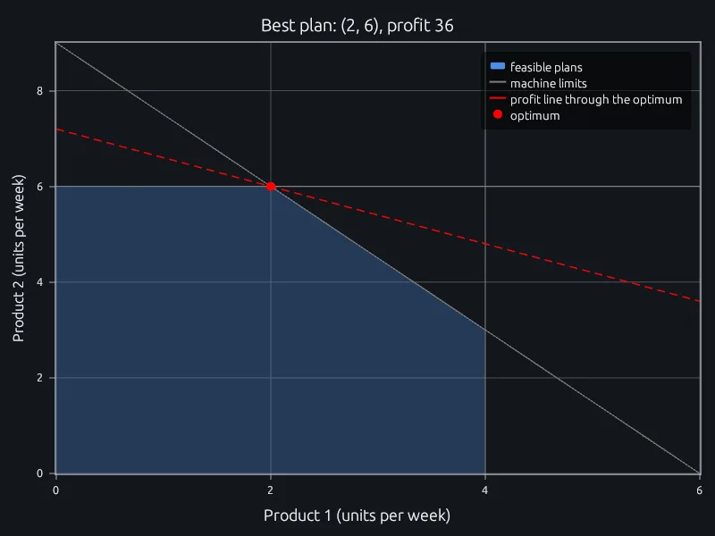

# Production planning as a linear program with linprog

[](https://runmat.com/sandbox?example=optimization-production-plan)

This example plans a week's production of two products that share three machines. Product 1 earns
3 per unit and product 2 earns 5; each machine has a fixed number of hours. `linprog` finds the best
plan: 2 units of product 1 and 6 of product 2, for a profit of 36. The figure shows the feasible
region, the machine limits and the profit line through the optimum.



## The problem

Product mix, blending, transport and staffing problems share one form: choose quantities to
maximize profit or minimize cost, subject to linear limits on shared resources. That is a linear
program. Here:

$$\max\ 3x_1 + 5x_2 \quad \text{s.t.}\quad x_1 \le 4,\ \ 2x_2 \le 12,\ \ 3x_1 + 2x_2 \le 18,\ \ x_1, x_2 \ge 0$$

Each row is one machine: hours per unit times units made, at most the hours available. The best
plan of a linear program always lies at a corner of the feasible region, where two or more limits
are met exactly. `linprog` minimizes, so the profit enters with its sign flipped.

## How the example works

1. **Set up the data**: profit per unit (negated), hours per unit on each machine, and hours
   available:

   ```matlab
   f = -[3 5];
   A = [1 0; 0 2; 3 2];
   b = [4; 12; 18];
   ```

2. **Solve** with both quantities non-negative:

   ```matlab
   [x, fval] = linprog(f, A, b, [], [], [0 0]);
   profit = -fval;
   ```

3. **Draw** the feasible region with `fill`, the three machine limits, the profit line
   3x₁ + 5x₂ = 36 and the optimum.

## Results

The best plan is 2 units of product 1 and 6 of product 2, a profit of 3·2 + 5·6 = 36. It sits at
the corner where machines 2 and 3 are both fully booked: 12 of 12 hours and 18 of 18. Machine 1
uses 2 of its 4 hours. In the figure the feasible region is a pentagon with corners at (0, 0),
(4, 0), (4, 3), (2, 6) and (0, 6). The dashed profit line touches it only at (2, 6); every other
plan lies below that line and earns less.

## What to try

1. Raise product 1's profit to 8. The optimum moves to the corner (4, 3), worth 47.
2. Add 2 hours to machine 3 with `b = [4; 12; 20]` and compare the new profit with the shadow
   prices in [shadow prices](../shadow-prices).
3. Require whole units with `intlinprog`, as in [the integer program](../integer-program).

## Files

- `production-plan.m`: the script: problem data, linprog and the feasible-region plot.
- `runmat.toml`: the project file.

## Related

- [Optimization in RunMat](https://runmat.com/math/optimization)
- [Shadow prices](../shadow-prices) and [integer program](../integer-program)
- Function reference: [`linprog`](https://runmat.com/docs/reference/builtins/linprog), [`fill`](https://runmat.com/docs/reference/builtins/fill)
- [Download RunMat](https://runmat.com/download)
