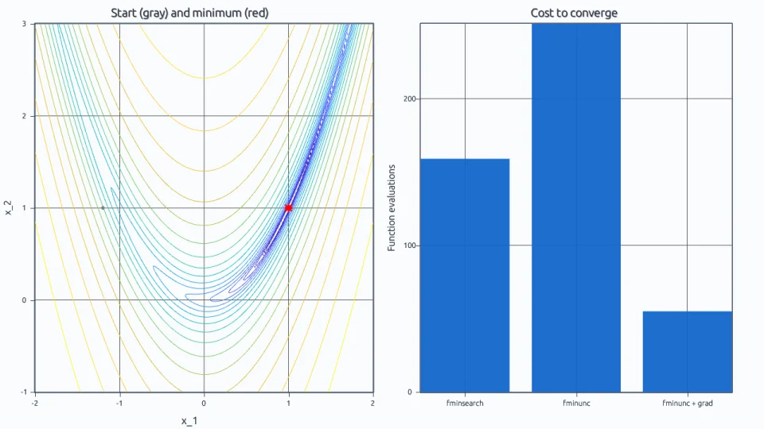

# Rosenbrock's function: fminsearch against fminunc, with and without a gradient

[](https://runmat.com/sandbox?example=optimization-rosenbrock-solvers)

This example minimizes Rosenbrock's banana function from the standard start (−1.2, 1) with three
solvers and counts the function evaluations each needs. All three reach the minimum at (1, 1).
`fminsearch` takes 159 evaluations, `fminunc` with finite-difference gradients 251, and `fminunc`
with the analytic gradient supplied 55.

<picture>
  <source media="(prefers-color-scheme: dark)" srcset=".artifacts/thumbnail.webp">
  
</picture>

## The problem

When each evaluation of the objective is a simulation run, evaluations are the cost of
optimizing. The choice of solver, and whether a gradient is available, can change that cost by
several times.

Rosenbrock's function is the standard test:

$$f(x_1, x_2) = 100\,(x_2 - x_1^2)^2 + (1 - x_1)^2$$

Its minimum, f = 0 at (1, 1), sits at the end of a long, curved, narrow valley. Solvers find the
valley quickly and then have to follow its curve.

- `fminsearch` uses the Nelder-Mead simplex method. It needs no gradient and tolerates noise.
- `fminunc` is a quasi-Newton method. Without a gradient it estimates one by finite differences,
  which costs one extra evaluation per variable at every step.
- Supplying the gradient removes those extra evaluations and makes each step more accurate.

## How the example works

1. **Define the objective**, and a second version that also returns the gradient:

   ```matlab
   f = @(x) 100*(x(2) - x(1)^2)^2 + (1 - x(1))^2;
   g = [-400*x(1)*(x(2) - x(1)^2) - 2*(1 - x(1)); 200*(x(2) - x(1)^2)];
   ```

2. **Run the three solvers** from (−1.2, 1):

   ```matlab
   [x1, f1, e1, o1] = fminsearch(f, x0);
   [x2, f2, e2, o2] = fminunc(f, x0, opts);
   opts = optimoptions(opts, 'SpecifyObjectiveGradient', true);
   [x3, f3, e3, o3] = fminunc(@rosenbrock, x0, opts);
   ```

3. **Compare** the end points and `funcCount` from each output structure.

4. **Plot** the contours with the start and the minimum, and the evaluation counts as bars.

## Results

```
fminsearch                   x = (1.0000, 1.0000), 159 evaluations
fminunc, finite differences  x = (1.0000, 1.0000), 251 evaluations
fminunc, gradient supplied   x = (1.0000, 1.0000),  55 evaluations
```

The supplied gradient cuts `fminunc`'s cost from 251 to 55 evaluations, by a factor of 4.6. With
finite differences, `fminunc` costs more than the gradient-free `fminsearch` on this problem. In
the contour plot the valley curves from the start around to (1, 1); the bars show the three
counts side by side.

## What to try

1. Start from (−2, 2) and compare the three counts.
2. Extend to the 10-variable Rosenbrock function, where finite differences cost 10 extra
   evaluations per step, and compare the solvers again.
3. Check the analytic gradient against a finite-difference estimate at a few points before
   relying on it.

## Files

- `rosenbrock-solvers.m`: the script: objective and gradient, three solvers, counts and the two plots.
- `runmat.toml`: the project file.

## Related

- [Optimization in RunMat](https://runmat.com/math/optimization)
- [Stopping tests](../stopping-tests) and [local minima](../local-minima)
- Function reference: [`fminsearch`](https://runmat.com/docs/reference/builtins/fminsearch), [`fminunc`](https://runmat.com/docs/reference/builtins/fminunc), [`optimoptions`](https://runmat.com/docs/reference/builtins/optimoptions)
- [Download RunMat](https://runmat.com/download)
