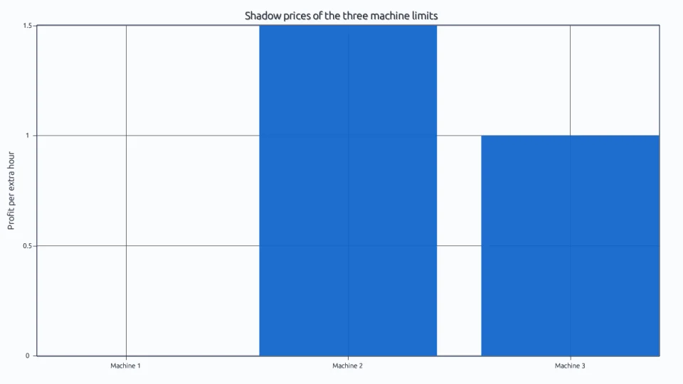

# Shadow prices from linprog: what one more machine hour is worth

[](https://runmat.com/sandbox?example=optimization-shadow-prices)

This example solves a two-product production plan with `linprog` and reads the shadow price of each
machine-hour limit from the Lagrange multipliers. The best plan makes 2 and 6 units for a profit of
36. One more hour on machine 2 would add 1.50, one more on machine 3 would add 1.00, and machine 1,
with 2 idle hours, has a shadow price of zero.

<picture>
  <source media="(prefers-color-scheme: dark)" srcset=".artifacts/thumbnail.webp">
  
</picture>

## The problem

An optimal plan answers what to make. The next question is usually which resource to expand:
overtime on a machine, another shift, more of a raw material. The shadow price of a constraint is
the change in the optimal objective per unit of extra capacity, valid while the same set of
constraints stays binding.

Linear programming gives shadow prices at no extra cost: they are the Lagrange multipliers of the
inequality constraints, returned as `lambda.ineqlin`. A constraint with slack has a shadow price of
zero, since more of a resource that is not used up adds nothing. The plan here is the one from
[production planning](../production-plan): profits of 3 and 5 per unit, and three machines with 4,
12 and 18 hours.

## How the example works

1. **Set up and solve** the linear program, asking for the multipliers:

   ```matlab
   f = -[3 5];
   A = [1 0; 0 2; 3 2];
   b = [4; 12; 18];
   [x, fval, flag, output, lambda] = linprog(f, A, b, [], [], [0 0]);
   ```

2. **Compare hours used with hours available** for each machine:

   ```matlab
   used = A*x;
   ```

3. **Report and plot** `lambda.ineqlin`, one shadow price per machine.

## Results

```
Best plan: 2 and 6 units, profit 36
Machine 1: 2 of 4 hours used; one more hour adds 0.00
Machine 2: 12 of 12 hours used; one more hour adds 1.50
Machine 3: 18 of 18 hours used; one more hour adds 1.00
```

The prices can be checked by re-solving. With 13 hours on machine 2, the optimum moves to 5/3 and
6.5 units, a profit of 37.5, up 1.50. With 19 hours on machine 3, it moves to 7/3 and 6 units, a
profit of 37, up 1.00. An extra hour on machine 2 is worth 50 % more than one on machine 3, so it
is the better place to add capacity if the two cost the same. Machine 1 is not a bottleneck.

## What to try

1. Re-solve with `b = [4; 13; 18]` and confirm the profit rises by 1.50.
2. Add 10 hours to machine 2. Past 18 hours, product 1 drops to zero and the price changes, so the
   rise is less than 15.
3. Raise product 1's profit to 8 and see which machines become binding.

## Files

- `shadow-prices.m`: the script: linprog with multipliers, hours used and the bar chart.
- `runmat.toml`: the project file.

## Related

- [Optimization in RunMat](https://runmat.com/math/optimization)
- [Production planning](../production-plan) and [integer program](../integer-program)
- Function reference: [`linprog`](https://runmat.com/docs/reference/builtins/linprog), [`bar`](https://runmat.com/docs/reference/builtins/bar)
- [Download RunMat](https://runmat.com/download)
