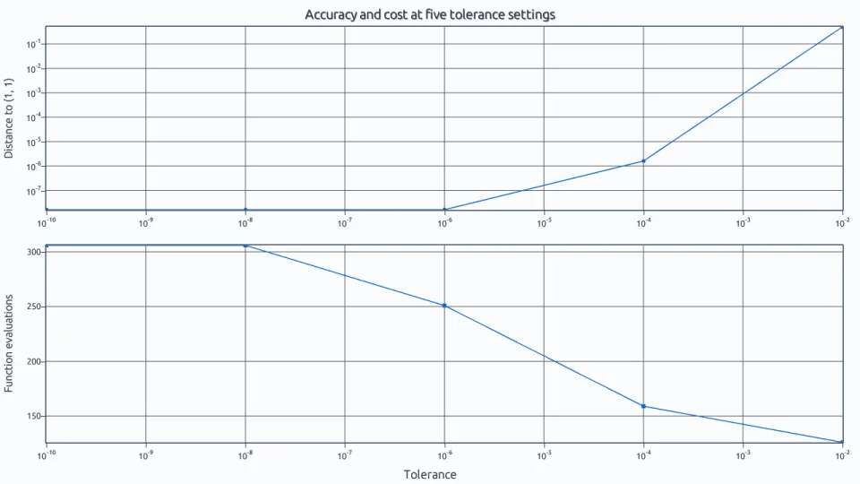

# Optimizer stopping tolerances: accuracy against cost with fminunc

[](https://runmat.com/sandbox?example=optimization-stopping-tests)

This example minimizes Rosenbrock's function with `fminunc` at five tolerance settings, from 10⁻²
to 10⁻¹⁰, and records the evaluations spent and the distance left to the true minimum at (1, 1).
Tightening from 10⁻² to 10⁻⁶ cuts the error from 0.50 to 1.6 × 10⁻⁸ for 125 more evaluations.
Tighter settings add up to 55 more evaluations and do not reduce the error further.

<picture>
  <source media="(prefers-color-scheme: dark)" srcset=".artifacts/thumbnail.webp">
  
</picture>

## The problem

An optimizer stops when a test says further work will not help. Three tests are common: the
gradient is small (optimality tolerance), the objective has stopped changing (function tolerance),
or the step has become tiny (step tolerance). The exit flag says which one fired. Loose tolerances
stop early with an inaccurate answer; tight ones spend evaluations, and below some level they buy
nothing, because rounding and finite-difference gradient error set a floor on the accuracy.

Rosenbrock's function, 100(x₂ − x₁²)² + (1 − x₁)², is a hard case for loose tolerances: along its
curved valley floor the objective changes very little, so a function-change test can be met far
from the minimum.

## How the example works

1. **Loop over five tolerances**, setting all three tests to the same value:

   ```matlab
   opts = optimoptions('fminunc', 'Display', 'off', 'OptimalityTolerance', tol(k), ...
       'FunctionTolerance', tol(k), 'StepTolerance', tol(k));
   [x, ~, flag, out] = fminunc(f, [-1.2 1], opts);
   ```

2. **Record** the distance to (1, 1), the evaluation count and the exit flag.

3. **Plot** the error on log-log axes and the evaluations on a log tolerance axis.

## Results

```
tolerance 1e-02: exitflag 2, 126 evaluations, error 5.0e-01
tolerance 1e-04: exitflag 2, 159 evaluations, error 1.6e-06
tolerance 1e-06: exitflag 1, 251 evaluations, error 1.6e-08
tolerance 1e-08: exitflag 1, 306 evaluations, error 1.6e-08
tolerance 1e-10: exitflag 2, 306 evaluations, error 1.6e-08
```

At 10⁻² the solver stops 0.50 from the minimum, on a small-step test
(exit flag 2). At 10⁻⁶ it stops on the gradient test (exit flag 1) with an error of 1.6 × 10⁻⁸.
Below that the error stays at 1.6 × 10⁻⁸ while the cost rises to 306 evaluations: the floor set by
finite-difference gradients in double precision. The figure shows the error falling steeply and
then flattening, and the evaluation count rising and then leveling off at 306.

## What to try

1. Supply the analytic gradient, as in [Rosenbrock with three solvers](../rosenbrock-solvers), and
   see whether the error floor drops.
2. Set only `OptimalityTolerance` and leave the other two at their defaults.
3. Start from (−2, 2) and compare the error at the loosest setting.

## Files

- `stopping-tests.m`: the script: five tolerance settings, errors, evaluations and the two plots.
- `runmat.toml`: the project file.

## Related

- [Optimization in RunMat](https://runmat.com/math/optimization)
- [Rosenbrock with three solvers](../rosenbrock-solvers) and [local minima](../local-minima)
- Function reference: [`fminunc`](https://runmat.com/docs/reference/builtins/fminunc), [`optimoptions`](https://runmat.com/docs/reference/builtins/optimoptions)
- [Download RunMat](https://runmat.com/download)
