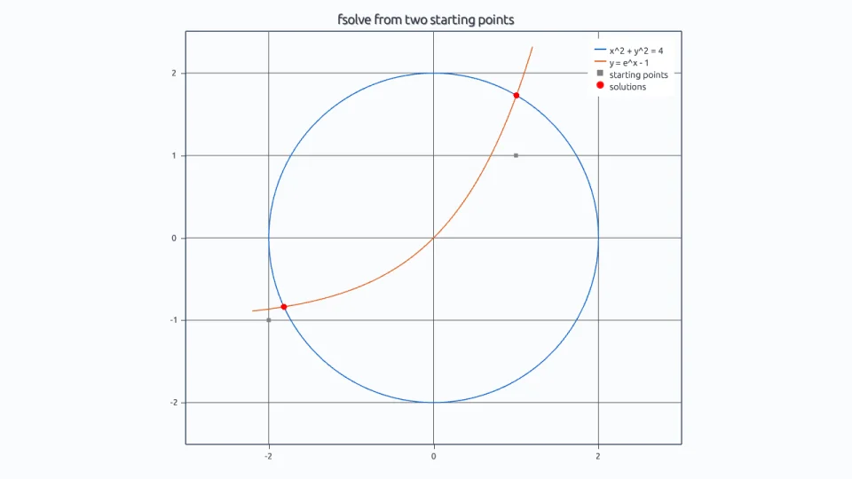

# Solve two nonlinear equations with fsolve: a circle meets an exponential

[](https://runmat.com/sandbox?example=optimization-two-equations)

This example finds where the circle x² + y² = 4 crosses the curve y = eˣ − 1 by solving the two
equations together with `fsolve`. The curves cross twice, and each of two starting points leads to
a different crossing. From (1, 1) the solver finds (1.0042, 1.7296); from (−2, −1) it finds
(−1.8163, −0.8374). Both residuals are below 4 × 10⁻⁹.

<picture>
  <source media="(prefers-color-scheme: dark)" srcset=".artifacts/thumbnail.webp">
  
</picture>

## The problem

Operating points, equilibria and design points are often the solution of several nonlinear
equations at once: a pump curve meeting a system curve, a circuit's node equations, the force
balance on a linkage. Written as F(v) = 0, a Newton-type solver such as `fsolve` improves a starting
guess using the Jacobian of F until the residual is small.

Nonlinear systems can have several solutions, and the solver returns the one its starting point
leads to. Plotting the equations, where possible, shows how many solutions there are and where to
start. Here the system is

$$F(x, y) = \begin{bmatrix} x^2 + y^2 - 4 \\ y - e^x + 1 \end{bmatrix} = 0$$

## How the example works

1. **Write the system** as one function returning both residuals:

   ```matlab
   F = @(v) [v(1)^2 + v(2)^2 - 4; v(2) - exp(v(1)) + 1];
   ```

2. **Solve from two starting points**, one near each crossing:

   ```matlab
   starts = [1 1; -2 -1];
   [sol(k, :), Fv, flag] = fsolve(F, starts(k, :), opts);
   ```

3. **Report** each solution, its residual norm and the exit flag.

4. **Plot** both curves, the starts and the solutions, with equal axis scaling.

## Results

```
From (1, 1): x = 1.0042, y = 1.7296, residual 1.0e-09, exitflag 1
From (-2, -1): x = -1.8163, y = -0.8374, residual 3.2e-09, exitflag 1
```

Both runs converge (exit flag 1) with residuals at the 10⁻⁹ level. The first crossing is in the
upper right, where the exponential climbs steeply through the circle; the second is in the lower
left, where the curve flattens toward y = −1. In the figure each gray start sits near the red
solution it reaches.

## What to try

1. Start from (0, 0) and see which crossing the solver reaches.
2. Change the circle's radius to 1 with `v(1)^2 + v(2)^2 - 1` and look at where the solutions move.
3. Start from a point far outside the circle, such as (3, −2), and check the exit flag.

## Files

- `two-equations.m`: the script: the system, fsolve from two starts and the plot.
- `runmat.toml`: the project file.

## Related

- [Optimization in RunMat](https://runmat.com/math/optimization)
- [Colebrook friction factor](../colebrook-friction) and [local minima](../local-minima)
- Function reference: [`fsolve`](https://runmat.com/docs/reference/builtins/fsolve), [`optimoptions`](https://runmat.com/docs/reference/builtins/optimoptions)
- [Download RunMat](https://runmat.com/download)
