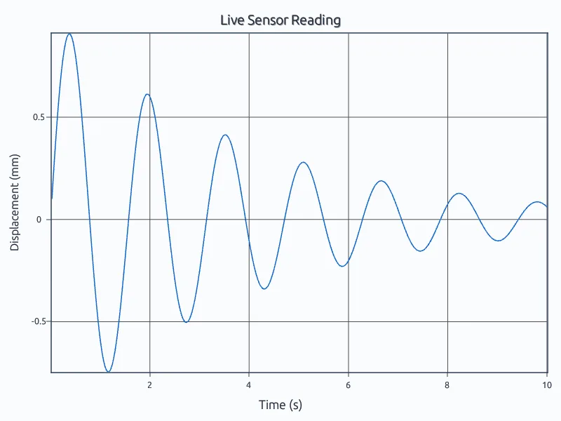

# Plot live data point by point with animatedline

[](https://runmat.com/sandbox?example=plotting-animated-line)

This example draws a decaying oscillation as it is computed, adding one point at a time to an
`animatedline` and redrawing after each. Over 400 steps it traces x(t) = e^(−0.25t)·sin(4t) from
t = 0.025 s to 10 s, the trace a displacement sensor would give on a ringing structure.

<picture>
  <source media="(prefers-color-scheme: dark)" srcset=".artifacts/thumbnail.webp">
  
</picture>

## The problem

An animated line is for data that arrives over time: a sensor stream, the residual of an
iterative solver, an optimizer's objective per iteration, or a simulation's state as it steps.
Instead of collecting every value and plotting once at the end, the script appends each new point
to an existing line object, so the figure shows progress while the loop runs.

## How the example works

1. **Create an empty line** and label the axes once, before the loop:

   ```matlab
   h = animatedline('LineWidth', 1.5);
   title('Live Sensor Reading');
   ```

2. **Append a point per step** and redraw:

   ```matlab
   for k = 1:400
       t = k/40;
       addpoints(h, t, exp(-0.25*t)*sin(4*t));
       drawnow;
   end
   ```

## Results

The finished figure shows the oscillation decaying over 10 s. The period is 2π/4 = 1.57 s, so
6.4 cycles fit in the window, and the envelope e^(−0.25t) falls to 0.082 by
t = 10 s.

## What to try

1. Add a second `animatedline` with a different color for the envelope `exp(-0.25*t)`.
2. Replace the formula with a value computed inside the loop, such as a running mean of `randn`
   draws, to watch it settle.
3. Call `drawnow` every tenth step (`if mod(k, 10) == 0`) for a faster loop with fewer redraws.

## Files

- `animated-line.m`: the script: the animated line and the loop that feeds it.
- `runmat.toml`: the project file.

## Related

- [Plotting in RunMat](https://runmat.com/math/plotting)
- [Plotting guide](https://runmat.com/docs/runtime/plotting)
- [Line plot](../plot) and [stairs plot](../stairs)
- Function reference: [`animatedline`](https://runmat.com/docs/reference/builtins/animatedline), [`addpoints`](https://runmat.com/docs/reference/builtins/addpoints), [`drawnow`](https://runmat.com/docs/reference/builtins/drawnow)
- [Download RunMat](https://runmat.com/download)
