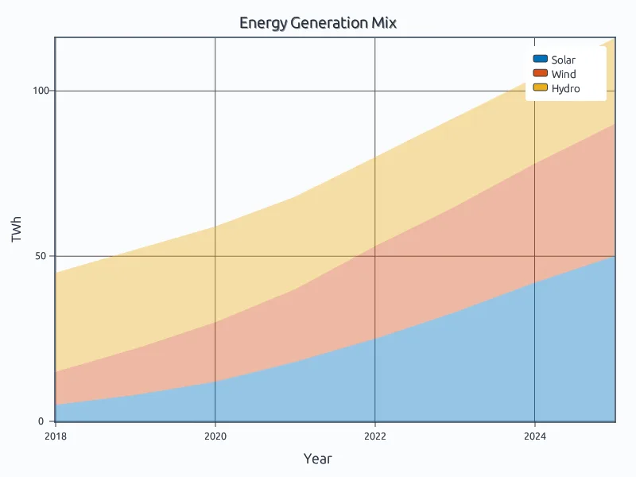

# Stacked area chart of energy generation by source

[](https://runmat.com/sandbox?example=plotting-area)

This example stacks solar, wind and hydro generation from 2018 to 2025 with `area`, so the top
edge of the chart is total generation and each band is one source's share. Total generation grows
from 45 TWh in 2018 to 116 TWh in 2025, with solar growing from 5 to 50 TWh while hydro slips from
30 to 26 TWh.

<picture>
  <source media="(prefers-color-scheme: dark)" srcset=".artifacts/thumbnail.webp">
  
</picture>

## The problem

A stacked area chart shows how a total splits into parts over time. It suits quantities that add
up: generation by source, cost by category, load by circuit, traffic by channel. The top line
reads as the total, and the thickness of each band reads as that part. Band thickness is harder to
compare than a line's height for every band except the bottom one, so a part that needs exact
comparison belongs at the bottom or on its own line plot.

## How the example works

1. **Arrange the data with one column per source**; `area` stacks the columns:

   ```matlab
   years = 2018:2025;
   mix = [solar; wind; hydro]';
   ```

2. **Draw the stacked areas** and name the bands:

   ```matlab
   area(years, mix);
   legend('Solar', 'Wind', 'Hydro');
   ```

## Results

Solar sits at the bottom and grows from 5 to 50 TWh, ten times its 2018 level. Wind, stacked on
top, grows from 10 to 40 TWh. Hydro, the top band, stays between 26 and 30 TWh, so its share of
the total falls from 67 % to 22 % even though its output barely changes.

## What to try

1. Reorder the columns to `[hydro; wind; solar]'` and compare how easily each trend reads.
2. Divide each row by its total, `mix ./ sum(mix, 2) * 100`, to plot shares in percent.
3. Plot the same data with `plot(years, mix)` to compare the sources' sizes directly.

## Files

- `area.m`: the script: the generation data and the stacked area chart.
- `runmat.toml`: the project file.

## Related

- [Plotting in RunMat](https://runmat.com/math/plotting)
- [Plotting guide](https://runmat.com/docs/runtime/plotting)
- [Grouped bar chart](../bar) and [pie chart](../pie)
- Function reference: [`area`](https://runmat.com/docs/reference/builtins/area), [`legend`](https://runmat.com/docs/reference/builtins/legend)
- [Download RunMat](https://runmat.com/download)
