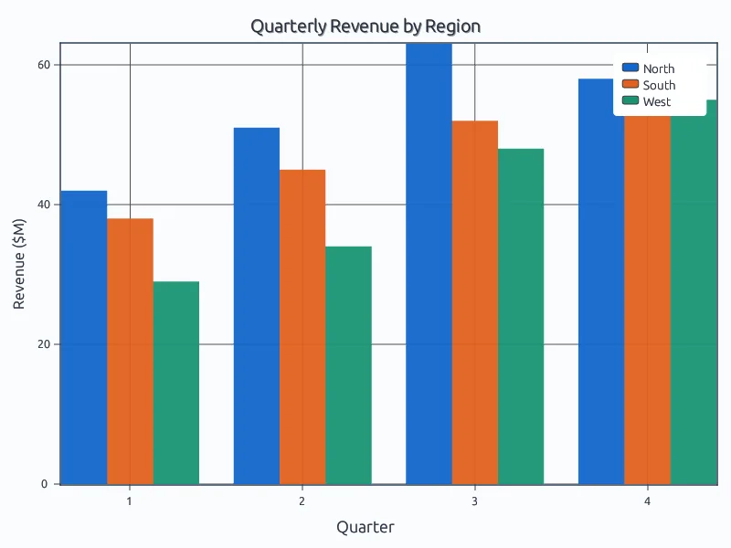

# Grouped bar chart of quarterly revenue by region

[](https://runmat.com/sandbox?example=plotting-bar)

This example draws quarterly revenue for three regions as grouped bars with `bar`, one group per
quarter and one bar per region. North leads in the first three quarters, peaking at $63M in Q3,
and South takes the lead in Q4 with $61M.

<picture>
  <source media="(prefers-color-scheme: dark)" srcset=".artifacts/thumbnail.webp">
  
</picture>

## The problem

A grouped bar chart compares a few categories across a few groups: revenue by region and quarter,
failure counts by mode and supplier, test scores by method and specimen. Bars start at zero, so
their heights compare directly, which makes them the standard choice for counts and totals. With
more than about five bars per group, or a continuous x-axis, a line plot reads better.

## How the example works

1. **Lay out the data** with one row per region and one column per quarter:

   ```matlab
   revenue = [42 51 63 58; 38 45 52 61; 29 34 48 55];
   ```

2. **Transpose it for `bar`**, which draws one group per row and one bar per column:

   ```matlab
   bar(revenue');
   legend('North', 'South', 'West');
   ```

## Results

All three regions grow from Q1 to Q4. North rises from $42M to $63M in Q3 and dips to $58M in Q4.
South climbs steadily from $38M to $61M. West, the smallest region, grows the most, from $29M to
$55M, close to doubling. The x-axis shows the quarters as 1 to 4; the script defines the labels in
`categories` without applying them.

## What to try

1. Label the groups: `set(gca, 'XTickLabel', categories)`.
2. Stack the regions with `bar(revenue', 'stacked')` to show the quarterly total.
3. Draw horizontal bars with `barh(revenue')`.

## Files

- `bar.m`: the script: the revenue table and the grouped bar chart.
- `runmat.toml`: the project file.

## Related

- [Plotting in RunMat](https://runmat.com/math/plotting)
- [Plotting guide](https://runmat.com/docs/runtime/plotting)
- [Stacked area chart](../area) and [pie chart](../pie)
- Function reference: [`bar`](https://runmat.com/docs/reference/builtins/bar), [`legend`](https://runmat.com/docs/reference/builtins/legend)
- [Download RunMat](https://runmat.com/download)
