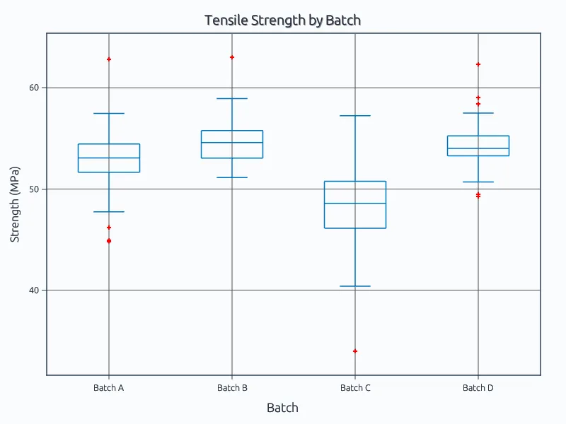

# Box plots to compare the spread and outliers of production batches

[](https://runmat.com/sandbox?example=plotting-boxplot)

This example draws a box plot of tensile strength for four production batches of 40 specimens
each, with `boxplot`. It shows each batch's median, quartiles and whiskers side by side and marks
outliers, including the two planted values: a 34 MPa specimen in Batch C and a 63 MPa specimen in
Batch B.

<picture>
  <source media="(prefers-color-scheme: dark)" srcset=".artifacts/thumbnail.webp">
  
</picture>

## The problem

A box plot summarizes a sample in five numbers: the median (center line), the first and third
quartiles (box edges), and whiskers reaching the most extreme points within 1.5 times the
interquartile range of the box. Points beyond the whiskers are drawn individually as outliers.
Placed side by side, box plots compare location and spread across batches, suppliers, machines or
test conditions, and flag specimens worth a second look, at a glance.

## How the example works

1. **Simulate four batches** with different means (52, 55, 49 and 54 MPa) and standard deviations
   (3, 2, 4 and 2.5 MPa), and plant two outliers:

   ```matlab
   rng(3);
   strength = [52 55 49 54] + randn(40, 4) .* [3 2 4 2.5];
   strength(5, 3) = 34;
   strength(12, 2) = 63;
   ```

2. **Draw one box per column**, labeled by batch:

   ```matlab
   boxplot(strength, 'Labels', groups);
   ```

## Results

Batch B has the highest median and Batch C the lowest and the widest box, matching the means and
spreads the batches were drawn with. Batch D has the tightest box. The planted 34 MPa value appears
as an outlier below Batch C and the 63 MPa value above Batch B. Batch A also shows several points
below its lower whisker; with 40 normal draws per batch, a few points past the whiskers are
expected.

## What to try

1. Raise Batch C's spread to 8 MPa and see whether the 34 MPa specimen still counts as an outlier.
2. Raise the sample to 400 specimens per batch and count how many points fall past the whiskers.

## Files

- `boxplot.m`: the script: four simulated batches, two planted outliers and the box plot.
- `runmat.toml`: the project file.

## Related

- [Plotting in RunMat](https://runmat.com/math/plotting)
- [Statistics in RunMat](https://runmat.com/math/statistics)
- [Histogram](../histogram) and [error bars](../errorbar)
- Function reference: [`boxplot`](https://runmat.com/docs/reference/builtins/boxplot), [`randn`](https://runmat.com/docs/reference/builtins/randn)
- [Download RunMat](https://runmat.com/download)
