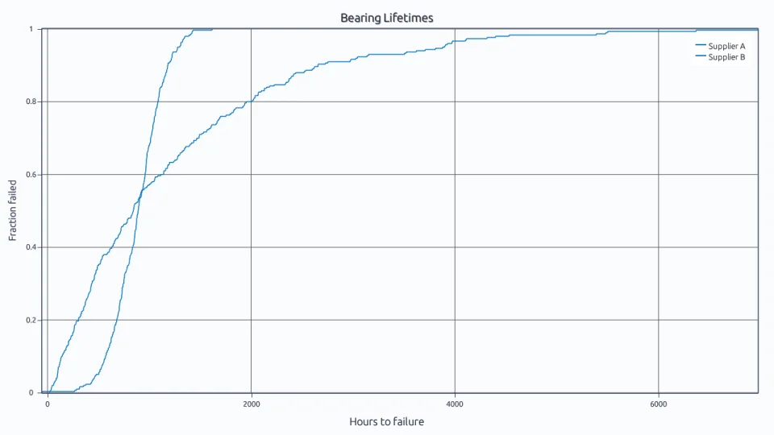

# Compare bearing lifetimes from two suppliers with empirical CDFs

[](https://runmat.com/sandbox?example=plotting-cdfplot)

This example compares 300 bearing lifetimes from each of two suppliers with `cdfplot`, which draws
the empirical cumulative distribution: the fraction of bearings failed by each number of hours.
Supplier A's lifetimes are exponential with a mean of 1200 h; Supplier B's are normal with a mean of
900 h and a standard deviation of 250 h. The two curves cross, so neither supplier is better at
every age.

<picture>
  <source media="(prefers-color-scheme: dark)" srcset=".artifacts/thumbnail.webp">
  
</picture>

## The problem

An empirical CDF plots every observation, with no bins to choose, which makes it a good way to
compare reliability data, measurement errors or response times between two groups. Reading it
across gives percentiles: the hours by which 10 % of bearings have failed (the B10 life) sits
where the curve crosses 0.1. Reading it up gives the fraction failed by a given age, the number a
warranty period depends on.

## How the example works

1. **Simulate lifetimes** for both suppliers with a fixed seed:

   ```matlab
   rng(9);
   lifetime_a = -1200*log(rand(300, 1));
   lifetime_b = 900 + 250*randn(300, 1);
   ```

2. **Draw both empirical CDFs** on the same axes:

   ```matlab
   cdfplot(lifetime_a);
   hold on;
   cdfplot(lifetime_b);
   ```

## Results

Supplier A's curve rises immediately: exponential lifetimes include many early failures. Supplier
B's stays near zero for the first few hundred hours, then climbs steeply around its 900 h mean and
reaches 1 before 2000 h, while A's long tail runs past 6000 h. From the two distributions the
curves cross at about 923 h, where 54 % of each population has failed. Below that age B is the
more reliable supplier; above it, A. In the captured figure both curves are drawn in the same blue,
so the steep curve is Supplier B.

## What to try

1. Read off the B10 life for each supplier by adding `yline(0.1)`.
2. Raise the sample to 3000 per supplier and look at how closely the steps follow the smooth
   population curves.
3. Overlay the exponential CDF `1 - exp(-x/1200)` to check Supplier A's fit.

## Files

- `cdfplot.m`: the script: the two simulated lifetime samples and their empirical CDFs.
- `runmat.toml`: the project file.

## Related

- [Plotting in RunMat](https://runmat.com/math/plotting)
- [Statistics in RunMat](https://runmat.com/math/statistics)
- [Q-Q plot](../qqplot) and [histogram](../histogram)
- Function reference: [`cdfplot`](https://runmat.com/docs/reference/builtins/cdfplot), [`rand`](https://runmat.com/docs/reference/builtins/rand)
- [Download RunMat](https://runmat.com/download)
