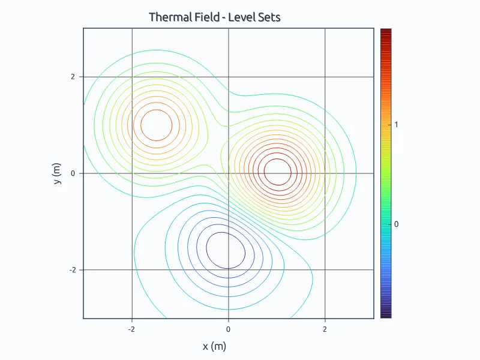

# Contour plot of a 2-D field: level sets of a temperature map

[](https://runmat.com/sandbox?example=plotting-contour)

This example draws 20 contour lines of a field made from two warm peaks and one cold trough on a
120 × 120 grid, with `contour`. Each line joins points at the same value, so closed rings mark the
peaks and the trough, and closely spaced lines mark steep gradients.

<picture>
  <source media="(prefers-color-scheme: dark)" srcset=".artifacts/thumbnail.webp">
  
</picture>

## The problem

A contour plot shows a function of two variables on a flat page: temperature over a plate, pressure
over a wing, elevation on a map, or a cost function over two design variables. Its advantage over a
surface is that nothing is hidden behind anything else, and values can be read at any point. The
spacing of the lines gives the gradient: lines close together mean a steep change.

The field here is a sum of three Gaussians, peaks of height 2 at (1, 0) and 1.5 at (−1.5, 1), and a
trough of depth −1 at (0, −1.5):

```matlab
Z = 2*exp(-((X-1).^2 + Y.^2)) + 1.5*exp(-((X+1.5).^2 + (Y-1).^2)) - exp(-(X.^2 + (Y+1.5).^2));
```

## How the example works

1. **Sample the field** on a grid from −3 to 3 m in each direction:

   ```matlab
   [X, Y] = meshgrid(linspace(-3, 3, 120), linspace(-3, 3, 120));
   ```

2. **Draw 20 levels**, colored by value, with a color bar and equal axis scaling so circles stay
   circular:

   ```matlab
   contour(X, Y, Z, 20);
   colormap('turbo');
   colorbar;
   axis equal;
   ```

## Results

The figure shows two sets of nested warm rings, the taller peak at the right, and a set of cool
rings below center around the trough. Between the right peak and the trough the lines crowd
together, marking the steepest gradient in the field.

## What to try

1. Pass explicit levels, `contour(X, Y, Z, -1:0.25:2)`, to draw lines at round values.
2. Switch to [filled contours](../contourf) with `contourf` to shade the bands.
3. Add the gradient field with [`quiver`](../quiver) to see it run perpendicular to the lines.

## Files

- `contour.m`: the script: the three-Gaussian field and the contour plot.
- `runmat.toml`: the project file.

## Related

- [Plotting in RunMat](https://runmat.com/math/plotting)
- [Plotting guide](https://runmat.com/docs/runtime/plotting)
- [Filled contours](../contourf) and [3-D contours](../contour3)
- Function reference: [`contour`](https://runmat.com/docs/reference/builtins/contour), [`meshgrid`](https://runmat.com/docs/reference/builtins/meshgrid), [`colorbar`](https://runmat.com/docs/reference/builtins/colorbar)
- [Download RunMat](https://runmat.com/download)
