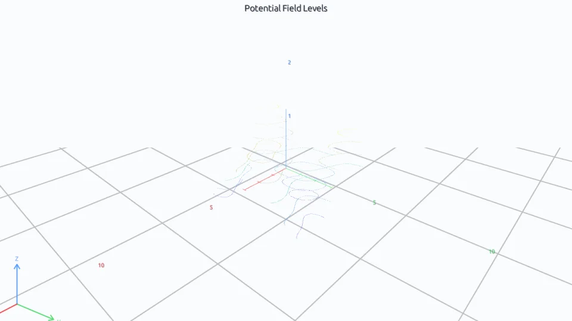

# 3-D contour plot: level lines drawn at their own heights

[](https://runmat.com/sandbox?example=plotting-contour3)

This example draws seven contour levels of a potential field, from −0.9 to 0.9 in steps of 0.3,
with `contour3`. Each line sits at the height of its level, so the stack of lines outlines the
shape of the field in three dimensions without drawing a surface.

<picture>
  <source media="(prefers-color-scheme: dark)" srcset=".artifacts/thumbnail.webp">
  
</picture>

## The problem

A flat contour plot reads values off a map; a 3-D contour plot adds height so peaks and valleys
stand out as stacked rings. It suits fields where the shape matters as much as the values: a
potential, a response surface from a design study, or a fitted model over two inputs. Choosing the
levels explicitly puts lines at round values that are easy to compare.

The field is a product of sines and cosines with a tilted second harmonic:

```matlab
Z = sin(X).*cos(Y) + 0.25*cos(2*X + Y);
```

On the 100 × 100 grid it ranges from about −1.25 to 1.24, so the outer levels ±0.9 form small
rings near the extremes.

## How the example works

1. **Sample the field** on a 100 × 100 grid from −3 to 3 and choose the levels:

   ```matlab
   [X, Y] = meshgrid(linspace(-3, 3, 100), linspace(-3, 3, 100));
   levels = [-0.9 -0.6 -0.3 0 0.3 0.6 0.9];
   ```

2. **Draw the contours in 3-D** with thick lines, then set the viewing angle:

   ```matlab
   contour3(X, Y, Z, levels, 'LineWidth', 2);
   view(42, 28);
   ```

## Results

The contour lines form rings stacked by height around the field's peaks and pits, with the zero
level running between them. Rotating the view shows which rings sit above the zero level and
which below.

## What to try

1. Add the surface underneath with `surf(X, Y, Z); shading interp; hold on;` before `contour3`.
2. Change the view to `view(0, 90)` to look straight down and recover a flat contour map.
3. Use 15 automatic levels, `contour3(X, Y, Z, 15)`, and compare.

## Files

- `contour3.m`: the script: the potential field and the 3-D contour plot.
- `runmat.toml`: the project file.

## Related

- [Plotting in RunMat](https://runmat.com/math/plotting)
- [Plotting guide](https://runmat.com/docs/runtime/plotting)
- [Contour plot](../contour) and [surface with contours](../surfc)
- Function reference: [`contour3`](https://runmat.com/docs/reference/builtins/contour3), [`view`](https://runmat.com/docs/reference/builtins/view)
- [Download RunMat](https://runmat.com/download)
