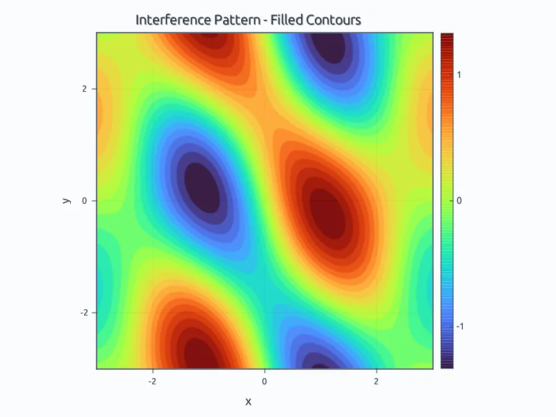

# Filled contour plot of an interference pattern

[](https://runmat.com/sandbox?example=plotting-contourf)

This example shades an interference pattern in 25 filled bands with `contourf`. Each band covers
one range of values, so warm lobes, cool lobes and the zero regions between them read as areas of
color instead of lines.

<picture>
  <source media="(prefers-color-scheme: dark)" srcset=".artifacts/thumbnail.webp">
  
</picture>

## The problem

Filled contours suit fields where regions matter more than exact lines: hot and cold zones on a
plate, high- and low-pressure areas, or where a stress exceeds a limit. With a color bar the bands
read as value ranges directly. The field here adds a tilted second harmonic to a sine-cosine
pattern:

```matlab
Z = sin(X) .* cos(Y) + 0.5*sin(2*X + Y);
```

The two terms reinforce in some places and cancel in others, which gives the slanted lobes. On the
150 × 150 grid the field ranges from −1.33 to 1.33.

## How the example works

1. **Sample the field** on a 150 × 150 grid from −3 to 3:

   ```matlab
   [X, Y] = meshgrid(linspace(-3, 3, 150), linspace(-3, 3, 150));
   ```

2. **Fill 25 bands** with the turbo colormap, a color bar and equal axis scaling:

   ```matlab
   contourf(X, Y, Z, 25);
   colormap('turbo');
   colorbar;
   axis equal;
   ```

## Results

The figure shows a pair of strong lobes near the center, a red one to the right and a dark blue one
to the left, with further lobes along the top and bottom edges. The lobes lean along the direction
the 2x + y term sets. Green and cyan regions between them mark values near zero.

## What to try

1. Use fewer bands, `contourf(X, Y, Z, 8)`, for a coarser map that is easier to read in print.
2. Set the second term's amplitude to 0 and look at the plain checkerboard of sin(x)·cos(y).
3. Try `colormap('parula')` and compare how the zero regions stand out.

## Files

- `contourf.m`: the script: the interference field and the filled contour plot.
- `runmat.toml`: the project file.

## Related

- [Plotting in RunMat](https://runmat.com/math/plotting)
- [Plotting guide](https://runmat.com/docs/runtime/plotting)
- [Contour lines](../contour) and [heatmap](../heatmap)
- Function reference: [`contourf`](https://runmat.com/docs/reference/builtins/contourf), [`colormap`](https://runmat.com/docs/reference/builtins/colormap), [`colorbar`](https://runmat.com/docs/reference/builtins/colorbar)
- [Download RunMat](https://runmat.com/download)
