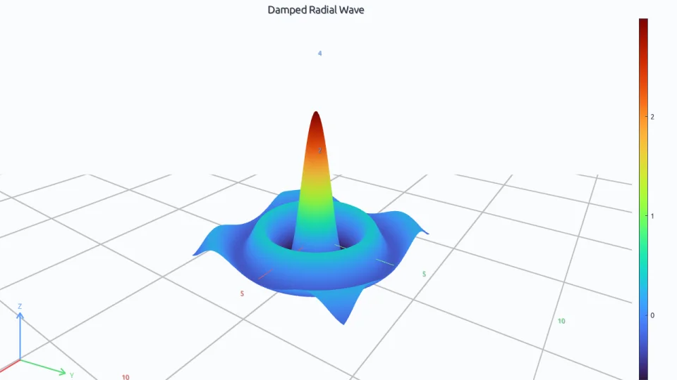

# 3-D surface plot of a damped radial wave with surf

[](https://runmat.com/sandbox?example=plotting-damped-radial-wave)

This example draws the surface z = sin(3r)/r over a 120 × 120 grid with `surf`, using smooth
shading and the turbo colormap. The result is a tall central peak, close to 3, surrounded by rings
that fall away with distance, the shape of a ripple spreading from a point.

<picture>
  <source media="(prefers-color-scheme: dark)" srcset=".artifacts/thumbnail.webp">
  
</picture>

## The problem

A surface plot shows a function of two variables as a height field, which makes peaks, ridges and
rings easy to see from a single view. Typical uses are a pressure or displacement field, a
response surface from a parameter sweep, or a 2-D kernel such as this one. The function sin(kr)/r
is the radial profile of a standing spherical wave around a point source.

## How the example works

1. **Build the grid and the radius**. Adding 0.01 to r avoids dividing by zero:

   ```matlab
   [X, Y] = meshgrid(linspace(-4, 4, 120));
   R = sqrt(X.^2 + Y.^2) + 0.01;
   Z = sin(3*R) ./ R;
   ```

2. **Draw the surface** with interpolated shading, a color bar and a set view angle:

   ```matlab
   surf(X, Y, Z);
   shading interp;
   colormap('turbo');
   colorbar;
   view(35, 25);
   ```

## Results

The central peak reaches 2.985 at the grid points nearest the origin, by the formula; the color
bar tops out there. The surface crosses zero where 3R is a multiple of π, at radii of 1.04, 2.08
and 3.13 once the 0.01 offset is removed, so the first ring is a trough just outside the peak. Each ring is lower than the last
because of the 1/r decay.

## What to try

1. Change the wave number from 3 to 6 for twice as many rings.
2. Replace `shading interp` with `shading faceted` to see the grid lines.
3. Draw the same data with [mesh](../mesh) or with [surfc](../surfc) to add contours below.

## Files

- `damped-radial-wave.m`: the script: the radial wave and its surface plot.
- `runmat.toml`: the project file.

## Related

- [Plotting in RunMat](https://runmat.com/math/plotting)
- [Plotting guide](https://runmat.com/docs/runtime/plotting)
- [Surface plot](../surf) and [mesh plot](../mesh)
- Function reference: [`surf`](https://runmat.com/docs/reference/builtins/surf), [`shading`](https://runmat.com/docs/reference/builtins/shading), [`meshgrid`](https://runmat.com/docs/reference/builtins/meshgrid)
- [Download RunMat](https://runmat.com/download)
