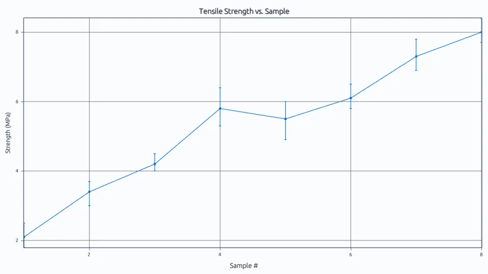

# Plot measurements with asymmetric error bars using errorbar

[](https://runmat.com/sandbox?example=plotting-errorbar)

This example plots the tensile strength of eight samples joined by a line, with a separate lower
and upper error for each point, using `errorbar`. Strength rises from 2.1 MPa for sample 1 to
8.0 MPa for sample 8, with one dip at sample 5.

<picture>
  <source media="(prefers-color-scheme: dark)" srcset=".artifacts/thumbnail.webp">
  
</picture>

## The problem

A measurement without its uncertainty cannot be compared with a limit or with another measurement.
Error bars show the uncertainty on the plot: a standard deviation, a confidence interval or an
instrument tolerance. When the uncertainty is not symmetric, as for a quantity measured on a log
scale or a percentile interval from a bootstrap, the lower and upper bars need different lengths.
`errorbar(x, y, neg, pos)` takes both.

## How the example works

1. **Set the values and the two error vectors**:

   ```matlab
   y = [2.1 3.4 4.2 5.8 5.5 6.1 7.3 8.0];
   neg = [0.3 0.4 0.2 0.5 0.6 0.3 0.4 0.3];
   pos = [0.4 0.3 0.3 0.6 0.5 0.4 0.5 0.4];
   ```

2. **Draw the points with asymmetric bars**, joined by a line:

   ```matlab
   errorbar(x, y, neg, pos, 'o-', 'LineWidth', 1.5);
   ```

## Results

The bars are widest at samples 4 and 5, 1.1 MPa from bottom to top. The drop from sample 4
(5.8 MPa) to sample 5 (5.5 MPa) is 0.3 MPa, smaller than either sample's uncertainty: the bar of
sample 5 reaches up to 6.0 MPa and that of sample 4 down to 5.3 MPa, so the overlap means the dip
may be noise.

## What to try

1. Pass one error vector, `errorbar(x, y, neg)`, for symmetric bars.
2. Plot without the line, `'o'`, when the samples are independent.

## Files

- `errorbar.m`: the script: the strength values, their errors and the plot.
- `runmat.toml`: the project file.

## Related

- [Plotting in RunMat](https://runmat.com/math/plotting)
- [Plotting guide](https://runmat.com/docs/runtime/plotting)
- [Box plots](../boxplot) and [line plot](../plot)
- Function reference: [`errorbar`](https://runmat.com/docs/reference/builtins/errorbar), [`plot`](https://runmat.com/docs/reference/builtins/plot)
- [Download RunMat](https://runmat.com/download)
