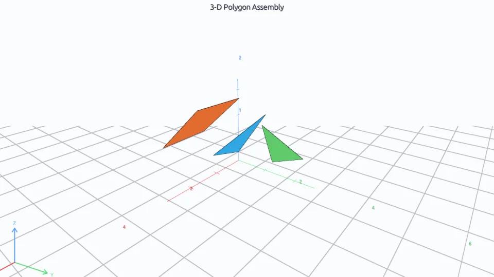

# Draw filled 3-D polygons with fill3

[](https://runmat.com/sandbox?example=plotting-fill3)

This example places three flat polygons in space with one `fill3` call: a blue triangle, an orange
quadrilateral and a green triangle, each given by the x, y and z coordinates of its corners and a
fill color.

<picture>
  <source media="(prefers-color-scheme: dark)" srcset=".artifacts/thumbnail.webp">
  
</picture>

## The problem

`fill3` draws polygons from their vertex coordinates. It is the quick way to show flat pieces in
3-D: panels of a structure, faces of a part, a cutting plane through a volume, or a region on a
tilted surface. For meshes with many shared vertices, [patch](../patch) with a face-vertex list is
the more compact form.

The orange quadrilateral has corners at z = 1.0 and z = 1.7, so it is a tilted panel raised above the
two triangles. The blue triangle runs from z = 0.2 to 1.2 and the green one from
0.4 to 1.3.

## How the example works

1. **List the corners** of each polygon as coordinate vectors:

   ```matlab
   x2 = [1.5 2.8 2.6 1.4];
   y2 = [0.1 0.1 1.1 1.2];
   z2 = [1.0 1.0 1.7 1.7];
   ```

2. **Draw all three in one call**, each followed by an RGB color:

   ```matlab
   fill3(x1, y1, z1, [0.2 0.7 0.95], x2, y2, z2, [0.95 0.45 0.2], x3, y3, z3, [0.4 0.85 0.45]);
   view(38, 25);
   ```

## Results

The figure shows the three filled polygons floating at different heights and angles above the
ground grid. From the 38° azimuth and 25° elevation of the view, the orange panel's tilt is clear,
and the triangles read as separate pieces.

## What to try

1. Raise the green triangle by adding 1 to `z3` and see where it sits against the orange panel.
2. Close a box by adding four side panels with matching corners.
3. Rotate to `view(0, 90)` to see the polygons' footprints on the x-y plane.

## Files

- `fill3.m`: the script: the corner coordinates and the fill3 call.
- `runmat.toml`: the project file.

## Related

- [Plotting in RunMat](https://runmat.com/math/plotting)
- [Plotting guide](https://runmat.com/docs/runtime/plotting)
- [Patch](../patch) and [3-D line plot](../plot3)
- Function reference: [`fill3`](https://runmat.com/docs/reference/builtins/fill3), [`view`](https://runmat.com/docs/reference/builtins/view)
- [Download RunMat](https://runmat.com/download)
