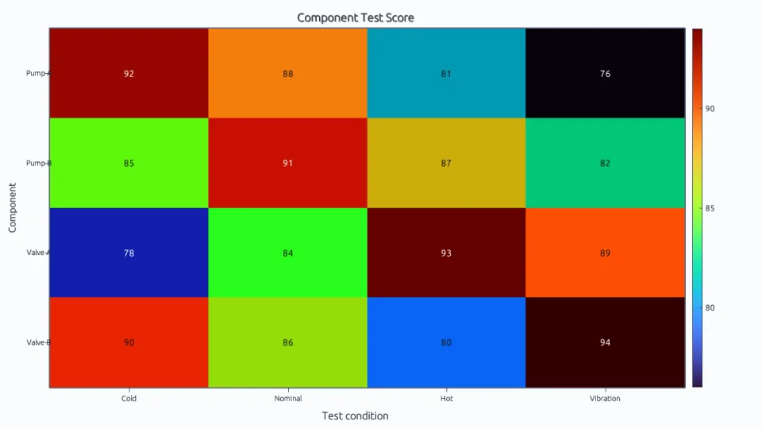

# Heatmap of test results by component and condition

[](https://runmat.com/sandbox?example=plotting-heatmap)

This example shows a 4 × 4 table of test scores, four components under four test conditions, as a
`heatmap` with each value printed in its cell. The highest score is 94 (Valve B under vibration)
and the lowest 76 (Pump A under vibration).

<picture>
  <source media="(prefers-color-scheme: dark)" srcset=".artifacts/thumbnail.webp">
  
</picture>

## The problem

A heatmap is for a table of numbers indexed by two categories: test results by part and condition,
defect counts by line and shift, correlation coefficients, or a confusion matrix. Color shows the
pattern at a glance and the printed values give the exact numbers, so the chart works both as a
picture and as a table. Labels come from the category names, so the axes need no numeric ticks.

## How the example works

1. **Set the table and its labels**, one row per component and one column per condition:

   ```matlab
   results = [92 88 81 76; 85 91 87 82; 78 84 93 89; 90 86 80 94];
   conditions = {'Cold', 'Nominal', 'Hot', 'Vibration'};
   components = {'Pump A', 'Pump B', 'Valve A', 'Valve B'};
   ```

2. **Draw the heatmap** and set its title, labels and colormap through the returned object:

   ```matlab
   h = heatmap(conditions, components, results);
   h.Title = 'Component Test Score';
   h.Colormap = 'turbo';
   h.ColorbarVisible = true;
   ```

## Results

Each component scores best under a different condition: Pump A in the cold (92), Pump B at
nominal (91), Valve A in the heat (93) and Valve B under vibration (94). The diagonal of the table
holds those best scores. Vibration splits the components most, from 76 for Pump A to 94 for
Valve B.

## What to try

1. Sort the rows by mean score before plotting to group strong and weak components.
2. Subtract each row's mean to show which conditions help or hurt each component.
3. Switch the colormap to `'parula'` and compare how the extremes stand out.

## Files

- `heatmap.m`: the script: the score table and the heatmap.
- `runmat.toml`: the project file.

## Related

- [Plotting in RunMat](https://runmat.com/math/plotting)
- [Plotting guide](https://runmat.com/docs/runtime/plotting)
- [Image plot of a matrix](../imagesc) and [filled contours](../contourf)
- Function reference: [`heatmap`](https://runmat.com/docs/reference/builtins/heatmap), [`colormap`](https://runmat.com/docs/reference/builtins/colormap)
- [Download RunMat](https://runmat.com/download)
