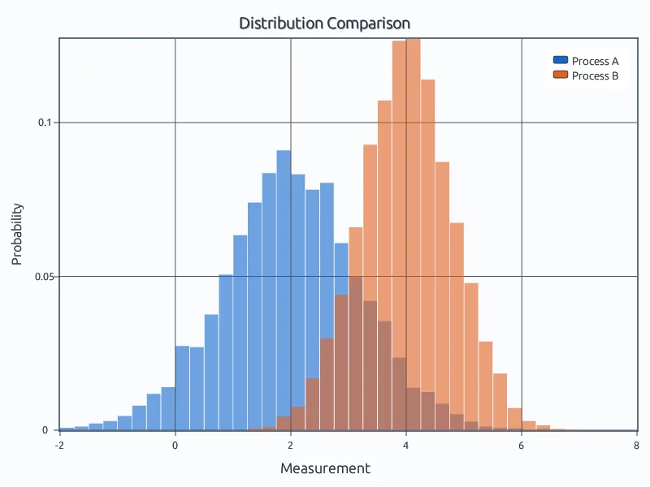

# Compare two distributions with overlapping histograms

[](https://runmat.com/sandbox?example=plotting-histogram)

This example draws histograms of 5000 measurements from each of two processes on the same axes,
with shared bin edges and probability normalization, using `histogram`. Process A is centered at 2
with a standard deviation of 1.2 and Process B at 4 with 0.8, so the two overlap between about 2
and 4.

<picture>
  <source media="(prefers-color-scheme: dark)" srcset=".artifacts/thumbnail.webp">
  
</picture>

## The problem

A histogram shows the shape of a sample: where it centers, how wide it is, whether it is skewed or
has two modes. Comparing two samples on one plot needs two settings. Shared bin edges make the bars
line up, so heights compare bin by bin. Probability normalization scales each histogram so its bars
sum to 1, so samples of different sizes compare fairly. Transparent bars keep both visible where
they overlap.

## How the example works

1. **Simulate the two processes** with a fixed seed:

   ```matlab
   rng(7);
   a = 2 + 1.2*randn(1, 5000);
   b = 4 + 0.8*randn(1, 5000);
   ```

2. **Draw both histograms** with 0.25-wide bins from −2 to 8, normalized to probability:

   ```matlab
   h1 = histogram(a, 'BinEdges', -2:0.25:8, 'Normalization', 'probability');
   set(h1, 'DisplayName', 'Process A');
   hold on;
   h2 = histogram(b, 'BinEdges', -2:0.25:8, 'Normalization', 'probability');
   ```

3. **Add a legend** with `legend()`, which picks up the display names.

## Results

Process B's histogram is taller and narrower than Process A's. With 0.25-wide bins the normal
formula puts the peak bin near 0.25/(σ√(2π)): 0.125 for B and 0.083 for A. The two density curves
cross at about 3.0, so a measurement above 3 is more likely to come from Process B.

## What to try

1. Change `'Normalization'` to `'pdf'` so the bar heights become densities and integrate to 1.
2. Use 0.1-wide bins and look at how much noisier the bars become.
3. Shift Process B's mean to 3 and look at how much more the histograms overlap.

## Files

- `histogram.m`: the script: two simulated samples and the overlaid histograms.
- `runmat.toml`: the project file.

## Related

- [Plotting in RunMat](https://runmat.com/math/plotting)
- [Statistics in RunMat](https://runmat.com/math/statistics)
- [Empirical CDFs](../cdfplot) and [box plots](../boxplot)
- Function reference: [`histogram`](https://runmat.com/docs/reference/builtins/histogram), [`randn`](https://runmat.com/docs/reference/builtins/randn), [`legend`](https://runmat.com/docs/reference/builtins/legend)
- [Download RunMat](https://runmat.com/download)
