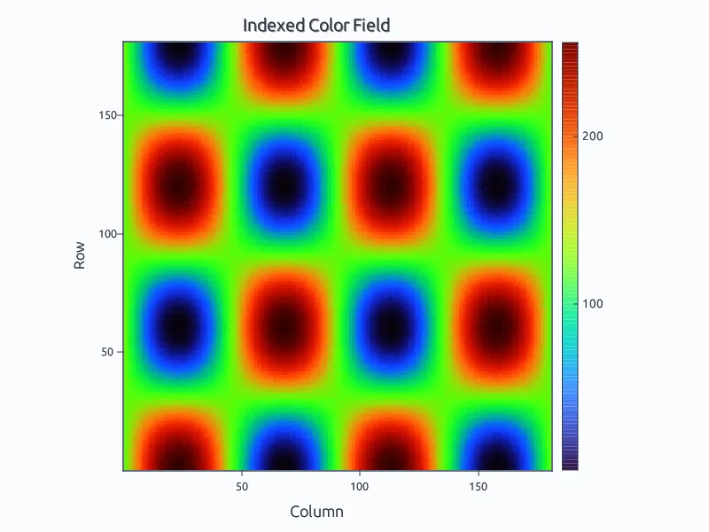

# Display an indexed-color image from a matrix with image

[](https://runmat.com/sandbox?example=plotting-image)

This example builds a 180 × 180 matrix of colormap indices from a smooth sine-cosine pattern and
displays it with `image`, which uses each value directly as a row number in the colormap. The
pattern's indices run from 1 to 64.

<picture>
  <source media="(prefers-color-scheme: dark)" srcset=".artifacts/thumbnail.webp">
  
</picture>

## The problem

An indexed image stores a color number per pixel instead of a color. Classified maps, label masks
from segmentation, material IDs on a cross-section and palette images all work this way: the
value in each cell picks an entry from the colormap. `image` displays such a matrix without
rescaling, so value 1 is the first colormap color and value k the k-th. For data that should be
stretched over the whole colormap, [imagesc](../imagesc) is the scaled counterpart.

## How the example works

1. **Make a pattern between 0 and 1** on a 180 × 180 grid:

   ```matlab
   [X, Y] = meshgrid(linspace(0, 1, 180), linspace(0, 1, 180));
   pattern = 0.5 + 0.5*sin(4*pi*X).*cos(3*pi*Y);
   ```

2. **Map it to integer indices** from 1 to 64:

   ```matlab
   color_index = round(1 + 63*pattern);
   ```

3. **Show the indices as colors** with the turbo colormap and a color bar:

   ```matlab
   image(color_index);
   colormap('turbo');
   colorbar;
   ```

## Results

The figure shows a checkerboard of bright and dark blobs from the product sin(4πx)·cos(3πy). `colormap('turbo')` has 256 entries and the indices stop at 64, so the image uses only
the first quarter of the colormap, the dark and blue end, and the color bar runs to 256.

## What to try

1. Use a 64-entry colormap, `colormap(turbo(64))`, so the indices span every color.
2. Or scale the indices to 256 entries: `color_index = round(1 + 255*pattern)`.
3. Display `pattern` itself with `imagesc` and compare.

## Files

- `image.m`: the script: the index matrix and the indexed image.
- `runmat.toml`: the project file.

## Related

- [Plotting in RunMat](https://runmat.com/math/plotting)
- [Plotting guide](https://runmat.com/docs/runtime/plotting)
- [Scaled image with imagesc](../imagesc) and [grayscale image with imshow](../imshow)
- Function reference: [`image`](https://runmat.com/docs/reference/builtins/image), [`colormap`](https://runmat.com/docs/reference/builtins/colormap), [`colorbar`](https://runmat.com/docs/reference/builtins/colorbar)
- [Download RunMat](https://runmat.com/download)
