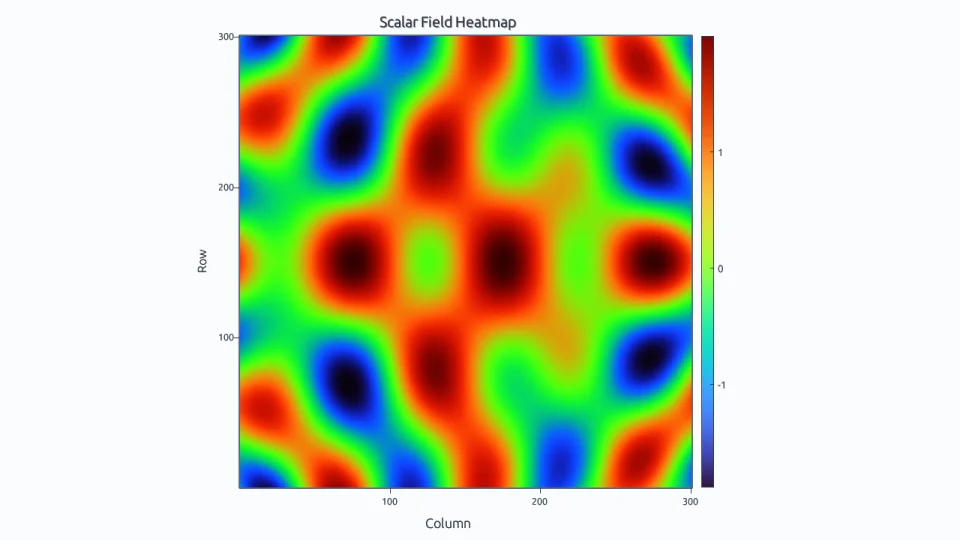

# Show a 2-D scalar field as a scaled color image with imagesc

[](https://runmat.com/sandbox?example=plotting-imagesc)

This example evaluates a scalar field on a 300 × 300 grid and draws it with `imagesc`, which
stretches the data range over the full colormap. On the grid the field runs from about −1.88 to
2.00, and the turbo colormap with a color bar maps that range from dark blue to dark red.

<picture>
  <source media="(prefers-color-scheme: dark)" srcset=".artifacts/thumbnail.webp">
  
</picture>

## The problem

`imagesc` is the fastest way to look at a matrix: a simulated field, a measured map, a spectrogram,
a correlation matrix or the residual of a solver on a grid. Each element becomes one pixel, and the
color scale is fitted to the data's own minimum and maximum, so the full colormap is always in use.
The axes count rows and columns, which suits matrix data; for physical coordinates, pass x and y
vectors as the first two arguments.

The field here is the sum of a product of harmonics and a saddle-shaped term:

```matlab
Z = sin(3*X) .* cos(2*Y) + cos(X.*Y);
```

## How the example works

1. **Sample the field** over −π to π in both directions:

   ```matlab
   [X, Y] = meshgrid(linspace(-pi, pi, 300), linspace(-pi, pi, 300));
   ```

2. **Draw the matrix scaled to its range**, with a colormap and color bar:

   ```matlab
   imagesc(Z);
   colormap('turbo');
   colorbar;
   axis equal;
   ```

## Results

The figure shows a lattice of warm and cool spots from the sin(3x)·cos(2y) term, distorted by
cos(xy), which equals 1 along both axes and oscillates faster toward the corners. The range above was computed from the same
formula on the same grid.

## What to try

1. Pass coordinates, `imagesc(linspace(-pi, pi, 300), linspace(-pi, pi, 300), Z)`, so the axes
   show x and y instead of column and row.
2. Fix the color limits with `caxis([-1 1])` to compare several fields on one scale.
3. Draw the same data with [contourf](../contourf) and compare.

## Files

- `imagesc.m`: the script: the scalar field and the scaled image.
- `runmat.toml`: the project file.

## Related

- [Plotting in RunMat](https://runmat.com/math/plotting)
- [Plotting guide](https://runmat.com/docs/runtime/plotting)
- [Indexed image](../image) and [heatmap](../heatmap)
- Function reference: [`imagesc`](https://runmat.com/docs/reference/builtins/imagesc), [`colormap`](https://runmat.com/docs/reference/builtins/colormap), [`colorbar`](https://runmat.com/docs/reference/builtins/colorbar)
- [Download RunMat](https://runmat.com/download)
