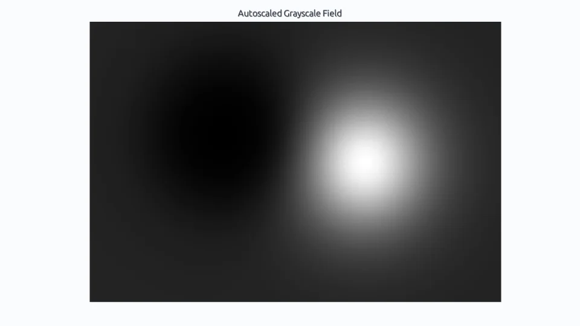

# Display a field as an autoscaled grayscale image with imshow

[](https://runmat.com/sandbox?example=plotting-imshow)

This example displays a 150 × 220 field with one bright spot and one dark spot using
`imshow(field, [])`. The empty brackets scale the display to the field's own range, about −0.67 to
0.99 on this grid, so the darkest pixel is black and the brightest white.

<picture>
  <source media="(prefers-color-scheme: dark)" srcset=".artifacts/thumbnail.webp">
  
</picture>

## The problem

`imshow` displays a matrix as an image with square pixels and no axes, the way image-processing
work expects: camera frames, depth maps, masks or simulated intensity fields. Without a display
range, grayscale data is expected to lie between 0 and 1, so negative values clip to black. Passing
`[]` as the display range maps the minimum to black and the maximum to white, which suits fields
with arbitrary units.

The field is a positive Gaussian of height 1 at (1, 0) and a negative one of depth 0.7 at
(−1, 0.4):

```matlab
field = exp(-0.8*((X-1).^2 + Y.^2)) - 0.7*exp(-((X+1).^2 + (Y-0.4).^2));
```

## How the example works

1. **Sample the field** on a 220-column by 150-row grid, x from −3 to 3 and y from −2 to 2:

   ```matlab
   [X, Y] = meshgrid(linspace(-3, 3, 220), linspace(-2, 2, 150));
   ```

2. **Show it autoscaled**:

   ```matlab
   imshow(field, []);
   ```

## Results

The bright spot appears right of center and the dark spot left of it, with the background a mid
gray, since zero sits about 40 % of the way from the minimum to the maximum. The range above was
computed from the same formula on the same grid.

## What to try

1. Call `imshow(field)` without the brackets and compare: values below 0 show as black.
2. Set an explicit range, `imshow(field, [-1 1])`, so zero maps to mid gray.
3. Add `colormap('turbo')` and `colorbar` to read values from the image.

## Files

- `imshow.m`: the script: the two-spot field and the autoscaled display.
- `runmat.toml`: the project file.

## Related

- [Plotting in RunMat](https://runmat.com/math/plotting)
- [Plotting guide](https://runmat.com/docs/runtime/plotting)
- [Scaled color image](../imagesc) and [indexed image](../image)
- Function reference: [`imshow`](https://runmat.com/docs/reference/builtins/imshow), [`meshgrid`](https://runmat.com/docs/reference/builtins/meshgrid)
- [Download RunMat](https://runmat.com/download)
