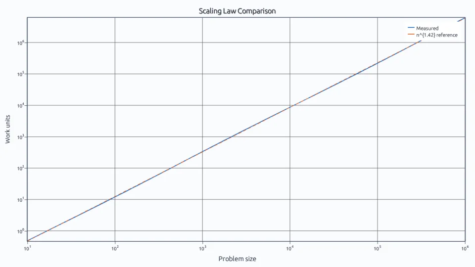

# Check a power-law scaling on log-log axes with loglog

[](https://runmat.com/sandbox?example=plotting-loglog)

This example plots the measured work of an algorithm against problem size from 10 to 10⁶ on
log-log axes with `loglog`, beside an n^1.42 reference line. On these axes a power law is a
straight line whose slope is the exponent, so the measured curve's close fit to the reference
confirms the 1.42 scaling.

<picture>
  <source media="(prefers-color-scheme: dark)" srcset=".artifacts/thumbnail.webp">
  
</picture>

## The problem

Log-log axes are the standard way to check a power law y = c·xᵖ. Taking logs gives
log y = log c + p·log x, a straight line with slope p. Engineers use this for solver cost against
mesh size, fatigue life against stress amplitude, convergence error against step size, and flow
against pressure drop. A deviation from the straight line shows where the scaling changes.

The "measured" data here is the power law 0.018·n^1.42 with a 3.5 % sinusoidal wobble in log n,
standing in for timing noise:

```matlab
measured = 0.018*problem_size.^1.42 .* (1 + 0.035*sin(log(problem_size)));
```

## How the example works

1. **Sample 300 log-spaced sizes** from 10 to 10⁶:

   ```matlab
   problem_size = logspace(1, 6, 300);
   ```

2. **Plot measured data and the reference** on log-log axes, naming each for the legend:

   ```matlab
   h1 = loglog(problem_size, measured);
   set(h1, 'LineWidth', 2, 'DisplayName', 'Measured');
   hold on;
   h2 = loglog(problem_size, reference, '--');
   ```

## Results

Over five decades of problem size the reference grows from 0.47 to 6.0 × 10⁶ work units by its
formula, 7.1 decades, as the 1.42 slope predicts. The 3.5 % wobble is too small to see at this
scale, so the measured line lies on the dashed reference.

## What to try

1. Fit the exponent: `p = polyfit(log10(problem_size), log10(measured), 1)` returns the slope in
   `p(1)`.
2. Plot the ratio `measured ./ reference` with [semilogx](../semilogx) to see the 3.5 % wobble.
3. Add an n² reference line to compare against quadratic scaling.

## Files

- `loglog.m`: the script: the synthetic measurements, the reference and the log-log plot.
- `runmat.toml`: the project file.

## Related

- [Plotting in RunMat](https://runmat.com/math/plotting)
- [Plotting guide](https://runmat.com/docs/runtime/plotting)
- [Semilog x-axis](../semilogx) and [semilog y-axis](../semilogy)
- Function reference: [`loglog`](https://runmat.com/docs/reference/builtins/loglog), [`logspace`](https://runmat.com/docs/reference/builtins/logspace), [`polyfit`](https://runmat.com/docs/reference/builtins/polyfit)
- [Download RunMat](https://runmat.com/download)
