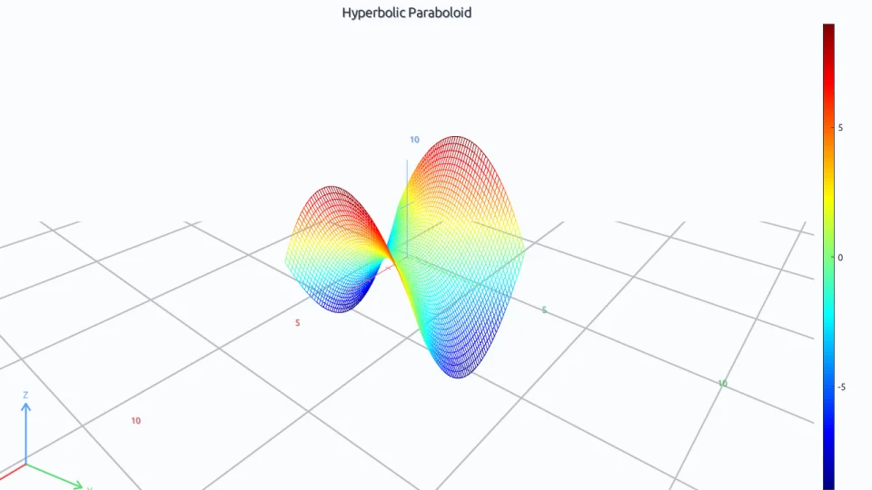

# Wireframe mesh plot of a saddle surface

[](https://runmat.com/sandbox?example=plotting-mesh)

This example draws the hyperbolic paraboloid z = x² − y² over a 60 × 60 grid as a colored
wireframe with `mesh`. The surface rises to 9 along the x-axis ends and falls to −9 along the
y-axis ends, with a saddle point at the origin.

<picture>
  <source media="(prefers-color-scheme: dark)" srcset=".artifacts/thumbnail.webp">
  
</picture>

## The problem

A mesh plot draws a surface as its grid lines only. The open wireframe shows the parts of the
surface that a solid [surf](../surf) would hide, and it shows the sampling grid itself, which helps
when checking the resolution of a computed field. A saddle is a good test shape: it curves up in
one direction and down in the other, the shape of the objective near a saddle point in
optimization or of a hyperbolic paraboloid roof.

## How the example works

1. **Sample the surface** on a 60 × 60 grid from −3 to 3:

   ```matlab
   [X, Y] = meshgrid(linspace(-3, 3, 60), linspace(-3, 3, 60));
   Z = X.^2 - Y.^2;
   ```

2. **Draw the wireframe**, colored by height with a color bar, from a set view angle:

   ```matlab
   mesh(X, Y, Z);
   colormap('jet');
   colorbar;
   view(40, 30);
   ```

## Results

The wireframe shows the saddle with its two raised red edges along ±x and two lowered blue edges
along ±y. The color bar spans −9 to 9, the values of x² − y² at (0, ±3) and (±3, 0). The flat
green band through the origin follows the lines y = ±x, where z = 0.

## What to try

1. Use a coarser grid, `linspace(-3, 3, 20)`, to see the individual grid cells.
2. Switch to [meshc](../meshc) to add a contour map below the wireframe.
3. Plot z = x² + y² instead, a bowl with a minimum at the origin, and compare.

## Files

- `mesh.m`: the script: the saddle surface and the wireframe plot.
- `runmat.toml`: the project file.

## Related

- [Plotting in RunMat](https://runmat.com/math/plotting)
- [Plotting guide](https://runmat.com/docs/runtime/plotting)
- [Mesh with contours](../meshc) and [surface plot](../surf)
- Function reference: [`mesh`](https://runmat.com/docs/reference/builtins/mesh), [`meshgrid`](https://runmat.com/docs/reference/builtins/meshgrid), [`view`](https://runmat.com/docs/reference/builtins/view)
- [Download RunMat](https://runmat.com/download)
